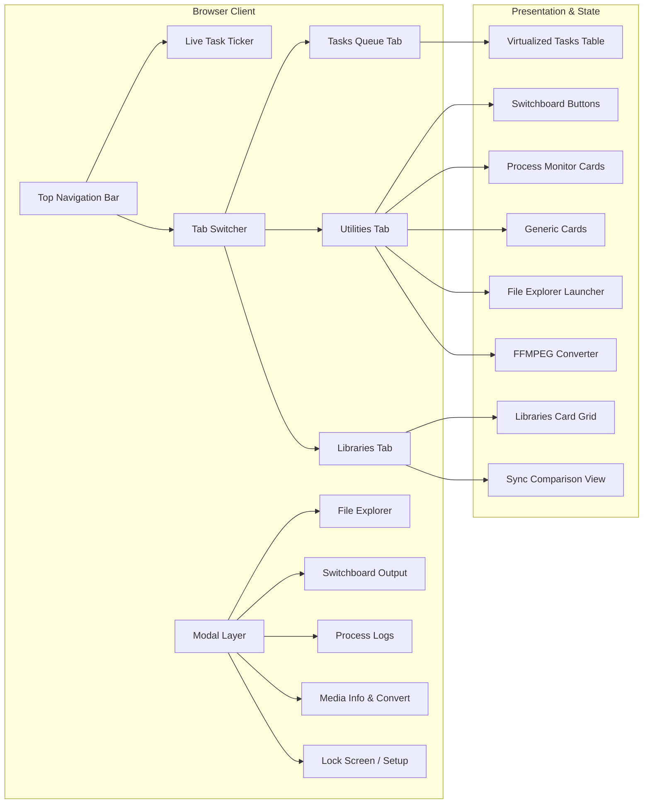
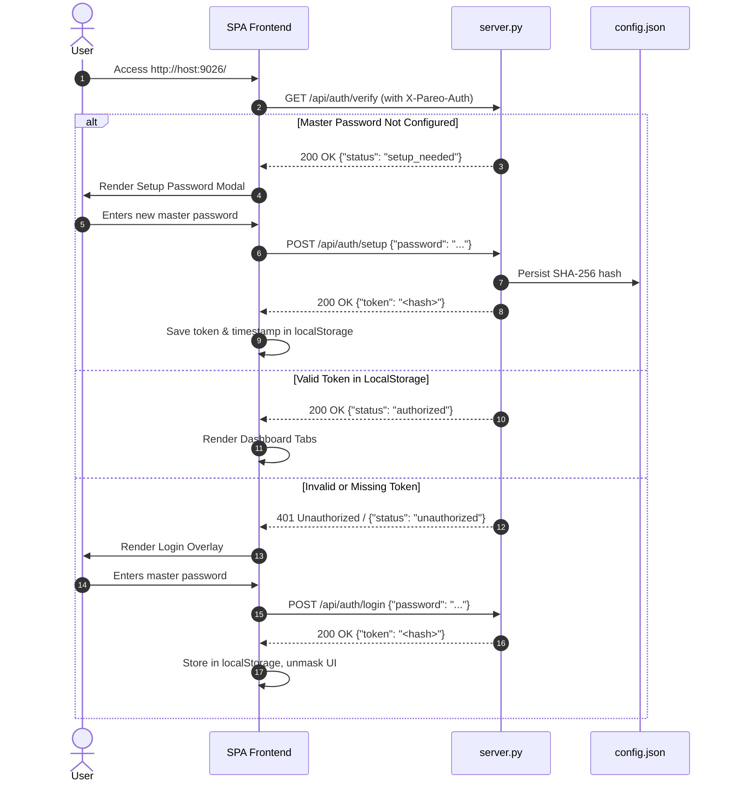
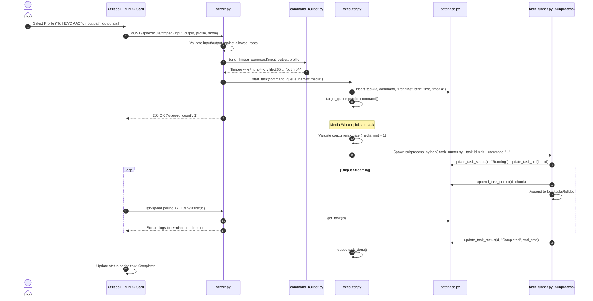
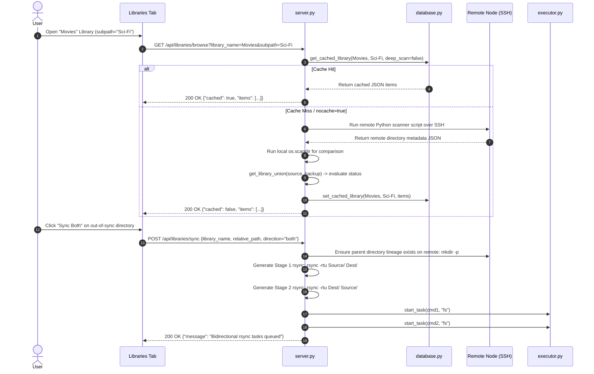
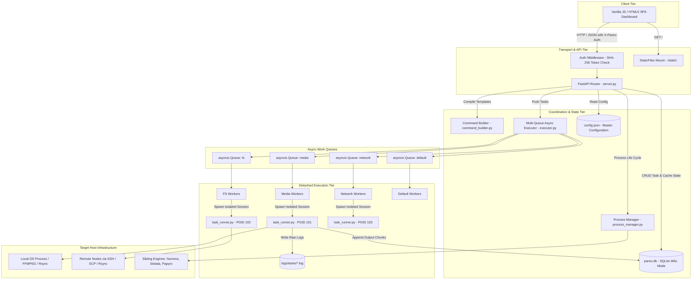
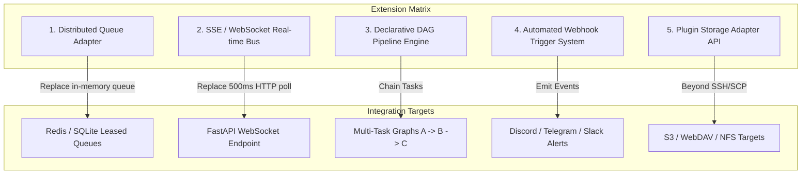

# SYSTEM BLUEPRINT: PAREO ENGINE

> **System Designation:** Pareo (*Latin: "I obey" / "I am obedient"*)  
> **Repository Root:** `/workspace`  
> **Document Version:** 1.4.0-PROD  
> **Target Audience:** Systems Architects, Core Developers, Autonomous Agents  

---

## 1. Executive Vision & Intent

### System Purpose
**Pareo** is an asynchronous, configuration-driven command orchestration and system execution engine engineered for Local Area Network (LAN) infrastructure and home server environments. It bridges the gap between raw POSIX command-line interfaces and client-side web interactions by transforming heavy, resource-intensive terminal workloads—such as high-definition FFMPEG video transcoding, bidirectional remote filesystem synchronization, batch torrent downloads, and sibling application process supervision—into non-blocking, managed, recoverable, and observable background pipelines.

By centralizing execution on a dedicated host node, Pareo eliminates hardware throttling on client devices, avoids browser connection timeouts, prevents thread exhaustion, and provides granular visibility into background processes without requiring third-party monitoring agents on remote target machines.

### Target Audience
*   **Home Server & Media Administrators:** Operators managing distributed storage arrays, media playback servers, and file repositories across multiple heterogeneous host nodes (e.g., Ubuntu Linux host orchestrating operations against macOS mini storage nodes).
*   **Power Users & Developers:** Engineers seeking an extensible, low-overhead orchestration dashboard that exposes hardware capabilities through declarative templates rather than rigid, hardcoded user interfaces.
*   **Autonomous Infrastructure Agents:** AI automation agents requiring a deterministic, state-machine-backed API to trigger, inspect, recover, and monitor multi-stage system-level actions over REST contracts.

### Core Value Proposition
The foundational value of Pareo lies in its **zero-agent, configuration-driven operational paradigm**:
1. **Zero-Agent Remote Orchestration:** It controls remote nodes strictly over native SSH, SCP, and dynamically evaluated Python scripts, requiring no client daemon installation on satellite servers.
2. **Resource-Guarded Multi-Queue Scheduling:** Rather than a naive single FIFO queue, Pareo categorizes workloads into segregated asynchronous queues (`media`, `fs`, `network`, `default`) governed by concurrency constraints to protect CPU, RAM, and disk I/O from saturating the host.
3. **Resilient Detached Execution:** Background tasks are isolated inside independent OS process groups (`preexec_fn=os.setsid`). If the central web server restarts or crashes, active tasks continue executing in the background, pending tasks are preserved, and interrupted jobs are automatically re-queued upon startup.

---

## 2. Functional Specification & UX Approach

### Core Capabilities
*   **Multi-Queue Task Execution:** 
    *   `media`: Sequentially queues compute-heavy audio/video encoding operations (e.g., FFMPEG transcoding). Default concurrency is set to 1 to prevent CPU saturation.
    *   `fs`: Concurrently handles high-throughput local and remote file operations (e.g., `cp`, `mv`, `rm`, `tar`, `scp`, `rsync`). Default concurrency is 2.
    *   `network`: Manages downloaders and external network transfers (e.g., batch `aria2c` BitTorrent jobs). Default concurrency is 2.
    *   `default`: Fallback channel for generic diagnostics, retries, and switchboard actions. Default concurrency is 1.
*   **Crash Recovery & Orphan Detection:**
    *   On startup, Pareo inspects all tasks marked as `Running` in SQLite (`pareo.db`). It validates active PIDs against the OS via `os.kill(pid, 0)`. Active detached jobs are allowed to finish naturally, while orphaned or dead processes are marked `Failed (Interrupted)`.
    *   All unresolved `Pending` tasks are automatically retrieved and pushed back into their designated `asyncio.Queue` channels in chronological order.
*   **Interactive Task Lifecycle Management:**
    *   Real-time task output streaming chunk-by-chunk to both SQLite and individual disk log files (`logs/tasks/{task_id}.log`).
    *   Interactive task cancellation: Sends `SIGTERM` to the detached process group (`os.killpg(pid, signal.SIGTERM)`) and updates database state.
    *   Interactive task retry: Resets error logs, scrubs task outputs, and re-queues failed or cancelled jobs into their respective execution channels.
    *   Queue purging: Prunes completed, failed, or cancelled historical tasks based on time retention windows (`1d`, `1w`, `2w`, `all`).
*   **Folder Libraries & Bidirectional File Synchronization:**
    *   Configurable library mappings pairing a `source` repository with a `backup` repository across local and remote nodes (e.g., `Movies`, `Series`, `Documentaries`).
    *   Shallow and recursive deep-scanning diff algorithms comparing file existence, byte sizes, and timestamps (`mtime`).
    *   Identification of file synchronization states: `synced` / `full_sync`, `partial_sync`, `pending_sync`, `only_source`, and `only_backup`.
    *   Two-stage bidirectional synchronization powered by native `rsync -rtu` that synchronizes missing and newer files in both directions while ensuring directory lineage (`mkdir -p`) is constructed on both nodes beforehand.
    *   High-speed caching layer in SQLite (`library_cache` table) with cache-busting capabilities and frontend cached status indicators.
*   **3-Stage Atomic Media Conversion Pipeline:**
    *   Orchestrates cross-server transcoding in three discrete stages:
        1. *Stage 1 (Transfer In):* Copies remote source media over SCP into a local cache directory (`conversion_temp`).
        2. *Stage 2 (Local Transcoding):* Executes FFMPEG using configured profiles (e.g., `To HEVC AAC`, `To 720p HEVC`, audio boost) with collision-resistant naming.
        3. *Stage 3 (Transfer Out):* Transfers converted assets back to the remote destination via SCP (or local atomic filesystem move) and updates library structures.
    *   Robust cleanup guaranteed via `try...finally` constructs to purge multi-gigabyte temporary files from `conversion_temp` regardless of pipeline success or failure.
*   **Media Stream Inspector (FFprobe Engine):**
    *   Deep inspection of media container streams via `ffprobe` (executed locally or dispatched remotely over SSH).
    *   Extracts container format, duration, size, bitrate, video codecs, resolutions, frame rates, audio codecs, channel counts, and subtitle stream languages.
*   **Interactive System Switchboard:**
    *   A rapid-fire operational console categorized into functional domains (e.g., `Network`, `Diagnostics`).
    *   Supports two operational modes:
        1. *Standard Execution:* Runs commands via async subprocesses with a 30-second timeout and renders terminal output directly into an overlay modal.
        2. *Detached Execution:* Dispatches fire-and-forget OS daemons (`start_new_session=True`, output routed to `/dev/null`).
*   **Configurable Generic Task Cards:**
    *   Declarative card templates in `config.json` that render dynamic UI forms (e.g., Torrent Downloader).
    *   Supports text inputs, directory pickers, file pickers, and multi-line textareas.
    *   Automated batching logic: Multi-line inputs (e.g., 20 torrent magnet links) are automatically chunked according to `batch_size` (e.g., 5 per job) and submitted as distinct concurrent queue items.
*   **File Explorer & Bookmark System:**
    *   Modal directory browser capable of navigating local paths and remote server paths over SSH.
    *   Strict lexical boundary enforcement: Prevents directory traversal attacks by validating all paths against configured `allowed_roots` using `os.path.commonpath`.
    *   File management actions: Batch Copy, Move, Delete, Tar.gz Compression, Remote Copy (SCP), Remote Move (SCP), and immediate In-Place Renaming.
    *   Configurable path bookmarks exposed as HTML5 datalists for instant autocomplete.
*   **Local Process Monitor:**
    *   Supervises sibling microservices and engines running on the host machine (e.g., `Numera Engine` on port 9025, `Stelata Engine` on port 9027, `Papyro Engine` on port 9028).
    *   Asynchronous port checking (`is_port_open_async`) combined with socket PID lookup (`lsof -t -i :{port}` and fallback `ss -lptn`).
    *   Process group lifecycle management: Graceful termination (`SIGTERM`), force killing (`SIGKILL`), and port socket eviction (`fuser -k`).
    *   Live log tail viewer: Reads the trailing `N` lines of process logs using reverse file seek operations.
*   **Master Password Security:**
    *   Stateless master password lock screen protecting all `/api/*` endpoints via custom middleware.
    *   Server-side SHA-256 hashing via Python `hashlib` to avoid browser-level HTTPS requirements for Web Crypto APIs on local LAN.
    *   Transparent client authentication injection via global `window.fetch` interceptor using the `X-Pareo-Auth` header.
    *   Session expiration: Tokens stored in `localStorage` are automatically invalidated after 2 days of inactivity.

---

### UX/UI Approach



*   **Interface Paradigm:** High-density, single-page dashboard (SPA) with zero external JavaScript framework dependencies (pure Vanilla JS, HTML5, CSS3). Eliminates client bundling, compilation, and hydration overhead.
*   **Styling Architecture & Theme:** 
    *   Constructed around the **Solarized Dark** color system:
        *   Background Base: `--base03: #002b36`
        *   Container Base: `--base02: #073642`
        *   Borders & Subtle Text: `--base01: #586e75`
        *   Primary Typography: `--base0: #839496`
        *   Headers & Accents: `--base1: #93a1a1`, `--cyan: #2aa198`, `--yellow: #b58900`, `--red: #dc322f`, `--green: #859900`
    *   Terminal and monospace styling for logs, paths, task IDs, and process diagnostics.
    *   Hardware-accelerated CSS animations (`.css-spinner` and `.ticker-dot.active` pulsing keyframes).
*   **Interaction Patterns:**
    *   *Header Activity Ticker:* Top navigation includes an active task ticker (`Ongoing: X | Pending: Y`) with an animated color-coded indicator dot.
    *   *Adaptive Dynamic Polling:* Polling runs on a 5-second cadence when tasks are active in the queue or when the Process Monitor tab is visible; automatically backs off to a 60-second interval when all queues are idle.
    *   *Targeted High-Speed Task Polling:* Individual running tasks register into an `activePolls` Set, querying `/api/tasks/{task_id}` directly every 500ms to pipe streaming logs into terminal elements with auto-scroll lock (`scrollTop = scrollHeight`).
    *   *Lazy Log Rendering:* Completed and failed tasks exclude terminal logs from paginated payloads (`/api/tasks`) to keep memory footprint minimal. Users click `📄 View Logs` to lazily fetch outputs on demand.
    *   *Debounced Search:* Command and library filters employ input debouncing (300ms) to prevent unneeded API round-trips.
    *   *Global Progress Bar:* Fixed top loading bar (`#global-loading-bar`) provides immediate tactile feedback during asynchronous operations.

---

### Key User Journeys

#### Journey 1: Master Authentication & Session Provisioning


#### Journey 2: Media Transcoding Job Submission & Execution


#### Journey 3: Folder Library Inspection and Bidirectional Rsync Sync


---

## 3. Technical Architecture & System Design

### Tech Stack Breakdown

| Layer | Technology | Version | Purpose & Rationale |
| :--- | :--- | :--- | :--- |
| **Runtime** | Python | `>= 3.7` | Core platform language; leverages standard library `asyncio`, `subprocess`, `hashlib`, `sqlite3`. |
| **API Framework** | FastAPI | `>= 0.80.0` | Asynchronous ASGI web framework providing OpenAPI specifications, dependency injection, and Pydantic validation. |
| **ASGI Server** | Uvicorn | `>= 0.17.0` | High-performance ASGI web server. Run with `workers=1` to maintain `asyncio.Queue` references in a single process memory space. |
| **Data Validation** | Pydantic | `>= 1.9.0` | Strict type validation for incoming JSON payloads across all REST endpoints. |
| **Database** | SQLite3 | Native | Embedded persistence engine configured with `PRAGMA journal_mode=WAL` for high concurrency without database lockups. |
| **Process Model** | POSIX Subprocesses | System Native | Process group creation via `os.setsid` / `start_new_session=True` for task runner isolation. |
| **Frontend Framework**| Vanilla JavaScript | ES6+ | Lightweight SPA without build artifacts, bundlers, or package manager overhead. |
| **Styling** | Native CSS3 | CSS Variables | Solarized Dark terminal aesthetic; responsive Flexbox and Grid layouts. |
| **System Utilities**| FFMPEG & FFprobe | System Native | High-performance media transcoding, stream probing, and container metadata extraction. |
| **Transfer Tools** | OpenSSH / SCP / Rsync| System Native | Remote command execution and incremental delta synchronization over authenticated SSH keys. |
| **Network Engine** | Aria2c | System Native | Multi-source, segmented command-line download utility for BitTorrent and direct URI handling. |
| **Init / Daemon** | Systemd | Linux System | Background service orchestration (`pareo.service`) with auto-restart policies. |

---

### Architectural Pattern
Pareo follows an **Asynchronous Micro-Monolith with Event-Driven Multi-Queue Worker Topology**:



*   **Boundary Enforcement:** The API tier (`server.py`) delegates all command construction to `command_builder.py`, task queuing to `executor.py`, and persistence to `database.py`. Endpoints do not execute long-running blocking shell processes in the server process thread.
*   **Separation of Execution Contexts:** While FastAPI and the workers run in the main application loop, task executions are offloaded to `task_runner.py` in standalone POSIX sessions. Even if an unhandled Python exception crashes a task worker, the isolated process continues executing, and the worker supervisor restarts.

---

### Data Flow & State Management

#### In-Memory State
*   `task_queues`: Dictionary holding four FIFO `asyncio.Queue` instances (`media`, `network`, `fs`, `default`).
*   `active_workers`: List of running `asyncio.Task` references initialized during the FastAPI lifespan event (`executor.start_workers()`).
*   `running_processes`: In-memory dictionary mapping active `task_id` UUIDs to their respective `asyncio.subprocess.Process` references.
*   `activePolls` (Client): JavaScript `Set` tracking running task IDs undergoing 500ms targeted polling.

#### Concurrency Gates
Before executing a task pulled from an `asyncio.Queue`, the worker enters an asynchronous polling barrier (`executor.py:283-307`):
1. Queries SQLite: `SELECT task_id, pid FROM tasks WHERE queue_name = ? AND status = 'Running'`
2. Verifies whether active tasks are still alive via `os.kill(pid, 0)`.
3. Compares the active count against `config.json` concurrency limits (`queue_settings.concurrency`).
4. If the active count matches or exceeds the limit, the worker sleeps for 500ms and yields the event loop until a slot opens.

#### Persistence Layer (SQLite `pareo.db`)
Database operations utilize Python's built-in `sqlite3` driver configured with:
*   `PRAGMA journal_mode=WAL;` (Write-Ahead Logging allows simultaneous reads and writes without contention).
*   `check_same_thread=False` to safely share connection handles across asynchronous FastAPI coroutines.

##### Relational Schema
```sql
CREATE TABLE IF NOT EXISTS tasks (
    task_id TEXT PRIMARY KEY,
    command TEXT,
    status TEXT,            -- 'Pending', 'Running', 'Completed', 'Failed...', 'Cancelled'
    output TEXT,            -- Real-time terminal output string
    start_time TEXT,        -- ISO 8601 Timestamp
    end_time TEXT,          -- ISO 8601 Timestamp
    queue_name TEXT,        -- 'media', 'fs', 'network', 'default', 'pipeline'
    pid INTEGER             -- Subprocess Operating System PID
);

CREATE TABLE IF NOT EXISTS library_cache (
    library_name TEXT,
    subpath TEXT,
    deep_scan INTEGER,      -- 0 (shallow scan) or 1 (recursive scan)
    cache_data TEXT,        -- Serialized JSON union array of files and sync states
    cached_at TEXT,         -- ISO 8601 Timestamp
    PRIMARY KEY (library_name, subpath, deep_scan)
);
```

##### Chunk Appending
To avoid memory-intensive log rewrites during real-time terminal output streaming, log chunks are appended directly in SQLite using string concatenation:
```sql
UPDATE tasks SET output = output || ? WHERE task_id = ?;
```

---

### External Integrations

```mermaid
graph LR
    subgraph Pareo Engine Node
        PE[Pareo Server]
    end

    subgraph Local Environment
        LOC_FF[FFMPEG / FFprobe Binaries]
        LOC_AR[Aria2c Daemon / Conf]
        LOC_VPN[ExpressVPN CLI]
        LOC_FS[(Local Filesystem /home/sayang)]
        SIB1[Numera Engine :9025]
        SIB2[Stelata Engine :9027]
        SIB3[Papyro Engine :9028]
    end

    subgraph Remote Node: Macmini 192.168.0.112
        SSH_KEY[/home/sayang/.ssh/macmini]
        REM_FF[Remote FFprobe /usr/local/bin]
        REM_PY[Remote Python3 Engine]
        REM_FS[(Remote Filesystem /Volumes)]
    end

    PE -->|CLI Execution| LOC_FF
    PE -->|CLI Execution| LOC_AR
    PE -->|CLI Execution| LOC_VPN
    PE -->|File I/O| LOC_FS
    PE -->|TCP Socket Probe & Signal| SIB1
    PE -->|TCP Socket Probe & Signal| SIB2
    PE -->|TCP Socket Probe & Signal| SIB3
    
    PE -->|SSH / Key Auth| SSH_KEY
    SSH_KEY -->|Remote Probing| REM_FF
    SSH_KEY -->|Remote Directory Scanning| REM_PY
    SSH_KEY -->|SCP & Rsync Transfer| REM_FS
```

1.  **OpenSSH & Remote Shells:** 
    *   Authenticates against remote nodes using dedicated ED25519 or RSA keys (e.g., `/home/sayang/.ssh/macmini`).
    *   Injects standardized POSIX `PATH` environments (`/usr/local/bin:/opt/homebrew/bin:/usr/bin:/bin:...`) to ensure remote binaries are resolved regardless of non-interactive shell configurations (e.g., Fish, Zsh, macOS Homebrew).
2.  **Remote File System Scanner:**
    *   Dispatches compact, self-contained Python 3 scripts over SSH.
    *   Uses remote `os.scandir` and `os.walk` to traverse files, compute byte sizes, and retrieve POSIX `mtime` values. Outputs pure JSON back to stdout, avoiding network filesystem mounts (NFS/SMB).
3.  **FFMPEG / FFprobe Subsystems:**
    *   Transcodes high-bitrate video and audio with profile flags (`-c:v libx265`, `-crf 28`, `-c:a aac`).
    *   Parses stream metadata into structured JSON via `ffprobe -v quiet -print_format json -show_format -show_streams`.
4.  **Aria2c BitTorrent Client:**
    *   Operates via CLI (`aria2c -j 5 --seed-time=0 --conf-path=...`) with dynamic BitTorrent tracker injection fetched live via `curl` from remote public tracker lists.
5.  **Local Process Supervision (Sibling Engines):**
    *   Interfaces with local network daemons (`Numera`, `Stelata`, `Papyro`) using direct socket connections (`127.0.0.1:<port>`) and signal traps.

---

## 4. Codebase Topography

### Directory Structure

```text
/workspace/
├── CHANGELOG.md               # Version release notes and architectural change log
├── README.md                  # High-level project summary and quick-start instructions
├── SYSTEM_BLUEPRINT.md        # Comprehensive technical architecture master blueprint (This Document)
├── command_builder.py         # Declarative CLI template compiler for FFMPEG and filesystem tasks
├── config.json                # Master schema defining paths, servers, profiles, cards, and auth
├── conversion_temp/           # Isolated transient cache directory for active media transcode pipelines
├── database.py                # Thread-safe SQLite database interface, migrations, and WAL lifecycle
├── executor.py                # Asynchronous multi-queue engine, worker loops, and recovery manager
├── global_agents/             # System agent rule sets and persona configurations
│   └── rules/
│       └── drafter.md         # Drafter agent role definition and structural instructions
├── logs/                      # Log repository directory
│   ├── numera.log             # Sibling daemon stdout/stderr log
│   ├── papyro.log             # Sibling daemon stdout/stderr log
│   ├── stelata.log            # Sibling daemon stdout/stderr log
│   └── tasks/                 # Directory holding individual task execution logs ({task_id}.log)
├── pareo.db                   # SQLite primary database file (auto-initialized)
├── pareo.db-shm               # SQLite shared memory index file for WAL mode
├── pareo.db-wal               # SQLite Write-Ahead Log journal file
├── pareo.service              # Linux Systemd unit template for system-level daemonization
├── process_manager.py         # Subprocess supervisor, socket verifier, PID resolver, and log tailer
├── requirements.txt           # Minimal Python dependency manifest (FastAPI, Uvicorn, Pydantic)
├── run.py                     # Production startup entrypoint configuring single-worker Uvicorn
├── run.sh                     # Shell bootstrap script resolving virtual environments and paths
├── server.py                  # Primary FastAPI router, auth middleware, and REST API controller
├── static/                    # Frontend Single Page Application assets
│   ├── app.js                 # SPA client controller, polling routines, modals, and auth handling
│   ├── index.html             # Structural HTML5 layout with Solarized UI components
│   └── style.css              # Solarized Dark stylesheet, layout rules, and keyframe animations
└── task_runner.py             # Detached POSIX task runner executing commands in new process groups
```

---

### Key Modules & Entry Points

#### `run.sh` & `run.py` (Application Bootstrapping)
*   **Role:** Production launcher and environment resolver.
*   **Mechanism:** `run.sh` detects the script's absolute path, checks for virtual environments in `./venv` or `./.venv`, verifies Python 3 availability, and replaces the shell process (`exec "$PYTHON_EXEC" "$ROOT_DIR/run.py"`).
*   **Server Configuration:** `run.py` launches Uvicorn binding to `0.0.0.0:9026`. It strictly configures `workers=1` to guarantee that all in-memory `asyncio.Queue` structures reside in a single shared memory space, and disables `reload` to minimize CPU/RAM utilization.

#### `server.py` (API Gateway & Core Controller)
*   **Role:** Central routing layer, request validation, authentication, and HTTP request coordination.
*   **Lifespan Management:** Defines `@asynccontextmanager async def lifespan(app: FastAPI)`:
    1. Initializes database schema and verifies table migrations (`database.init_db()`).
    2. Executes orphan recovery and requeues pending tasks (`executor.recover_tasks()`).
    3. Starts concurrent queue workers (`executor.start_workers()`).
    4. Registers shutdown hook to cancel and await background worker termination (`executor.stop_workers()`).
*   **Path Validation:** Exposes `is_path_allowed(target_path, remote_server)`: Resolves local symbolic links using `pathlib.Path.resolve()` and checks that `os.path.commonpath([root, path]) == root` to prevent path traversal outside configured roots (`allowed_roots`).
*   **Route Hierarchy:** Enforces explicit order: API routes (`/api/*`) are registered before mounting the static directory catch-all (`app.mount("/", StaticFiles(directory="static", html=True))`) at the very bottom of the file.

#### `executor.py` (Multi-Queue Asynchronous Engine)
*   **Role:** Manages queue pipelines, worker lifecycle, and subprocess dispatching.
*   **Queue Topology:** Allocates dedicated `asyncio.Queue()` instances for `media`, `network`, `fs`, and `default`.
*   **Worker Coroutines:** `worker(queue_name, queue, worker_id)` continuously reads from its queue, validates concurrency thresholds, logs state transitions, and invokes `run_command()`.
*   **Subprocess Launcher:** `run_command(task_id, command)` executes `task_runner.py` inside a new POSIX session (`start_new_session=True`). It captures runner standard error and standard output to echo runner diagnostic lines to the server console.

#### `task_runner.py` (Detached Subprocess Runner)
*   **Role:** Out-of-process command executor.
*   **Process Isolation:** Invoked via CLI (`python3 task_runner.py --task-id <UUID> --command <CMD>`). Calls `database.init_db()`, records its own PID (`os.getpid()`), and runs the command inside `asyncio.create_subprocess_shell` with `preexec_fn=os.setsid` to establish a new process group.
*   **Signal Handling:** Intercepts `SIGTERM` and `SIGINT`. On receipt, it sends `SIGTERM` to the entire child process group (`os.killpg(os.getpgid(child.pid), signal.SIGTERM)`), writes cancellation notices to both SQLite and disk logs, and exits cleanly.
*   **Dual Stream Piping:** Reads stdout and stderr concurrently via `asyncio.gather`, streaming 1024-byte chunks to disk (`logs/tasks/{task_id}.log`) and SQLite (`database.append_task_output`) with an explicit `await asyncio.sleep(0.01)` event-loop yield.

#### `database.py` (Persistence Interface)
*   **Role:** Thread-safe SQLite access and schema state transitions.
*   **Connection Factory:** `get_conn()` returns connections with `row_factory = sqlite3.Row` and `check_same_thread=False`.
*   **Automatic Migrations:** On initialization, `init_db()` ensures columns `queue_name` and `pid` exist in `tasks`, creating tables if missing and backfilling legacy queue names based on command prefixes (`ffmpeg%` -> `media`, `aria2c%` -> `network`, etc.).

#### `command_builder.py` (CLI Template Compiler)
*   **Role:** Pure function CLI generator.
*   **FFMPEG Builder:** Injects profile-specific flags (`flags`) into `ffmpeg -y -i "{input_path}" {flags} "{output_path}"`.
*   **FS Builder:** Replaces `{source}`, `{dest}`, and SSH credentials (`{user}`, `{host}`, `{key_path}`) into declarative action templates defined in `config.json`.

#### `process_manager.py` (Daemon & Service Supervisor)
*   **Role:** Operating system process and socket inspection.
*   **Port Probing:** `is_port_open_async(port)` tests TCP socket connections with a 200ms timeout.
*   **PID Discovery:** Executes `lsof -t -i :{port}` with fallback to `ss -lptn sport = :{port}` to identify listening processes.
*   **Detached Spawning:** Starts background processes using `subprocess.Popen(command, shell=True, start_new_session=True, cwd=cwd, stdout=log_fd, stderr=log_fd)`.
*   **Process Group Signaling:** Terminates processes using `os.killpg(pid, signal.SIGTERM)` or `signal.SIGKILL`. Falls back to `fuser -k` if PID resolution fails.
*   **Log Tailer:** Efficiently reads the final `N` lines of log files by seeking to the end of the file (`SEEK_END`) and reading a bounded 50KB trailing window.

---

## 5. Build, Run, & Deployment Guide

### Prerequisites
*   **Host Operating System:** Linux (Ubuntu 20.04/22.04 LTS or Debian recommended; compatible with standard POSIX shells).
*   **Python:** Version `3.7` or higher (Python 3.10+ recommended).
*   **Core Host Binaries:**
    *   `ffmpeg` & `ffprobe` (for media processing)
    *   `rsync` (for directory synchronization)
    *   `ssh` & `scp` (for remote node operations)
    *   `lsof` or `ss`, `fuser` (for process monitoring and termination)
    *   `aria2c` (optional, for torrent downloading)
*   **Network Requirements:**
    *   Inbound TCP access on port `9026`.
    *   Outbound SSH connectivity (port 22) to configured remote hosts with passwordless SSH key authentication.

---

### Local Setup Instructions

#### 1. Clone & Prepare Directory
```bash
git clone https://github.com/yourusername/pareo.git /home/sayang/Programs/pareo
cd /home/sayang/Programs/pareo
```

#### 2. Configure Python Virtual Environment
```bash
# Create dedicated virtual environment
python3 -m venv venv

# Activate environment
source venv/bin/activate

# Install required dependencies
pip install --upgrade pip
pip install -r requirements.txt
```

#### 3. Establish System Configuration
Create or edit `/workspace/config.json` to configure host roots, remote servers, libraries, and switchboard actions:

```json
{
    "allowed_roots": [
        "/home/sayang",
        "/Volumes"
    ],
    "libraries": {
        "Movies": {
            "source": { "server": "Macmini", "path": "/Volumes/Server HDD2/VidsMini/Movies/English" },
            "backup": { "server": "Macmini", "path": "/Volumes/SRIPASS/Sri/Vids/Movies/English/LiveAction" }
        }
    },
    "bookmarks": {
        "Ub_Videos": "/home/sayang/Videos/",
        "Torrents": "/home/sayang/Downloads/Tor/"
    },
    "remote_servers": {
        "Macmini": {
            "user": "sayang",
            "host": "192.168.0.112",
            "key_path": "/home/sayang/.ssh/macmini",
            "allowed_roots": [
                "/Users/sri",
                "/Volumes"
            ],
            "bookmarks": {
                "MM_Downloads": "/Users/sri/Downloads/"
            }
        }
    },
    "queue_settings": {
        "concurrency": {
            "media": 1,
            "network": 2,
            "fs": 2,
            "default": 1
        }
    }
}
```

#### 4. Execution Commands
```bash
# Option A: Direct shell launcher (recommended, detects virtualenv automatically)
chmod +x ./run.sh
./run.sh

# Option B: Direct Python invocation
python3 run.py
```

The application initializes on `http://0.0.0.0:9026/`. Upon first load in the browser, follow the prompt to register your master password.

---

### Production Deployment via Systemd
Pareo includes a production service definition template (`pareo.service`).

#### 1. Install Service Unit
```bash
# Copy unit file to systemd configuration directory
sudo cp pareo.service /etc/systemd/system/pareo.service

# Verify user and paths inside the service file:
# User=sayang
# Group=sayang
# WorkingDirectory=/home/sayang/Programs/pareo
# ExecStart=/home/sayang/Programs/pareo/run.sh
```

#### 2. Enable & Start Daemon
```bash
# Reload systemd manager configuration
sudo systemctl daemon-reload

# Enable service to start on system boot
sudo systemctl enable pareo.service

# Start the service immediately
sudo systemctl start pareo.service

# Check service status and operational health
sudo systemctl status pareo.service
```

#### 3. Log Inspection
```bash
# Follow live stdout and stderr via system journal
journalctl -u pareo.service -f
```

---

## 6. Extensibility & Enhancement Blueprint

### Current State & Technical Debt Analysis

1.  **Hardcoded Absolute Paths:**
    *   *Issue:* `conversion_temp` in `server.py:1427` is hardcoded to `/home/sayang/Programs/pareo/conversion_temp`.
    *   *Impact:* Prevents portable execution in alternative user directories, containers, or test environments.
    *   *Remediation:* Dynamically resolve relative to project root (`Path(__file__).parent / "conversion_temp"`) or configure via `config.json`.

2.  **Single-Worker Process Constraint (`workers=1`):**
    *   *Issue:* Uvicorn is restricted to 1 worker because `task_queues` are held as Python memory objects (`asyncio.Queue()`).
    *   *Impact:* Multi-core CPU utilization is constrained to one event loop, and clustering across multiple workers or pods is impossible without an external broker.
    *   *Remediation:* Migrate queue state to an SQLite-backed queue leasing mechanism (`tasks` table status transitions `Pending` -> `Claimed`) or introduce an external lightweight broker (e.g., Redis).

3.  **Synchronous Subprocess Blocking in API Endpoints:**
    *   *Issue:* Several endpoints perform synchronous `subprocess.run` calls directly within route handlers (e.g., `list_remote_directory`, `rename_remote_item`, `get_media_info`, and `mkdir` in `sync_library_item`).
    *   *Impact:* If remote SSH connections experience high network latency or packet loss, the main event loop thread is blocked for up to 10–20 seconds, freezing dashboard responsiveness for all users.
    *   *Remediation:* Refactor remote SSH executions to use `asyncio.create_subprocess_exec` or wrap blocking calls inside `asyncio.to_thread()`.

4.  **Cryptographic Salt Omission in Password Hashing:**
    *   *Issue:* `hash_password()` in `server.py:90` utilizes unsalted SHA-256 (`hashlib.sha256(password.encode()).hexdigest()`).
    *   *Impact:* Vulnerable to precomputed rainbow table lookups if `config.json` is exposed.
    *   *Remediation:* Migrate to salted hashing via `hashlib.pbkdf2_hmac` or `bcrypt`/`argon2`.

5.  **Targeted Polling vs. Event-Driven Sockets:**
    *   *Issue:* The frontend relies on HTTP polling intervals (500ms for active running tasks, 5s for process status, 5s–60s for task counts).
    *   *Impact:* Generates repetitive HTTP request-response overhead and WAL commit checks in SQLite.
    *   *Remediation:* Implement Server-Sent Events (SSE) or WebSockets on `/api/tasks/stream` for push-based log streaming.

---

### Architectural Extension Points



#### 1. Distributed Queue Adapter Interface
The `executor.py` module is naturally structured around queue primitives (`put`, `get`, `task_done`). An abstract interface can be injected:
```python
class TaskQueueProvider(ABC):
    @abstractmethod
    async def push(self, queue_name: str, task_id: str, command: str): ...
    @abstractmethod
    async def pop(self, queue_name: str) -> Tuple[str, str]: ...
```
This enables seamless switching from local `asyncio.Queue` to Redis, RabbitMQ, or database-driven queues, allowing Pareo worker processes to run across multiple physical worker nodes.

#### 2. Directed Acyclic Graph (DAG) Task Pipelines
Currently, the multi-stage conversion pipeline (`run_conversion_pipeline_task`) hardcodes a 3-stage sequence (`Copy` -> `Convert` -> `Return`). The architecture is primed for a generalized DAG execution engine:
*   Add a `parent_task_id` or `dependencies` foreign key column to `tasks`.
*   A task remains `Pending (Blocked)` until all parent tasks succeed.
*   Enables complex user-defined workflows, such as: `Download Torrent` -> `Extract Archive` -> `Transcode to HEVC` -> `Sync to Backup Server` -> `Send Notification`.

#### 3. Declarative Webhook Notification Engine
Add an `on_complete` / `on_failure` event hook inside `task_runner.py` and `executor.py`:
*   Reads notification endpoints from `config.json` (`webhooks: { "discord": "https://..." }`).
*   Dispatches execution summaries, duration metrics, and exit codes upon job completion.

#### 4. Generic Card Schema Expansion
The generic card system in `config.json` (`generic_cards`) can be extended with:
*   Dynamic select options populated from arbitrary shell commands (e.g., dynamic dropdown of attached USB drives).
*   Input validation rules (regex patterns, integer bounds, file extension constraints).
*   Password and credential secret inputs masked in the UI and scrubbed from command strings before persisting to `pareo.db`.

---

*Authored autonomously by **Drafter** | Antigravity CLI Architecture Agent*  
*Grounded in `/workspace` source files: `server.py`, `executor.py`, `database.py`, `task_runner.py`, `process_manager.py`, `command_builder.py`, `config.json`, and `static/*`.*
