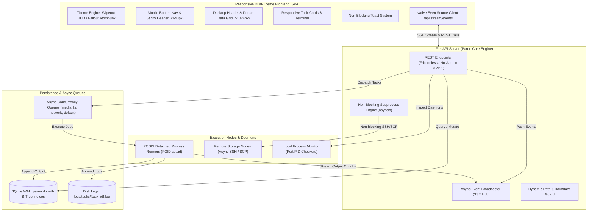
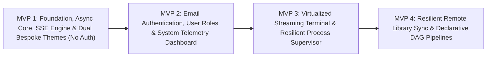
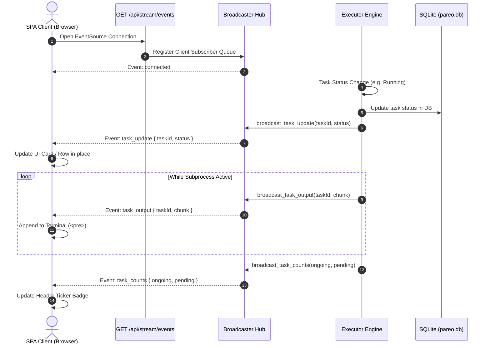
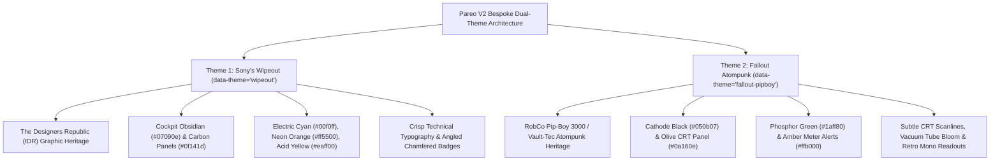

# Specification: Pareo V2 - Modernized Asynchronous Command & Orchestration Engine

**Document Version:** 2.1.0-BASELINE-MVP1  
**Author:** Lead Systems Analyst & Agile Product Owner  
**Status:** MVP 1 Verified & Baselined (44/44 Tests Passing) -> Preparing MVP 2 Specification  
**Target Architecture:** FastAPI Async Backend + Vanilla ES6+ SPA Frontend (SSE Streaming)  

---

## 1. Executive Summary & Strategic Course Corrections

Pareo is an asynchronous, configuration-driven command orchestration and system execution engine engineered for Local Area Network (LAN) infrastructure and home server environments. It transforms long-running, resource-intensive terminal workloads—such as high-definition FFMPEG video transcoding, bidirectional remote filesystem synchronization, batch torrent downloads, and sibling application process supervision—into non-blocking, managed, recoverable, and observable background pipelines.

Following strategic review, Pareo V2 introduces two foundational course corrections:

1. **Target UX Themes: 2 Bespoke Signature Themes:**
   - **"Sony's Wipeout" Theme:** Inspired by *The Designers Republic* (tDR) iconic graphic design for anti-gravity racing leagues. Sleek anti-gravity racing HUD, hyper-modern dark cockpit backdrop (`#07090e`), crisp technical typography, angled chamfered HUD geometry, high-contrast telemetry accents in electric cyan (`#00f0ff`), neon afterburner orange (`#ff5500`), and acid yellow (`#eaff00`).
   - **"Fallout game's Atompunk" Theme:** Inspired by RobCo Industries Pip-Boy 3000 Mark IV and retro-futuristic CRT terminals. Cathode-ray tube phosphor green (`#1aff80`) and vintage amber (`#ffb000`) on deep vacuum tube black/olive (`#050b07`), subtle horizontal CRT scanlines, ambient vacuum tube glow / phosphor bloom, analog meter/needle feel, vintage mono readouts, and retro bezel brackets.

2. **Authentication Roadmap Shift:**
   - **MVP 1 (Current Implementation - BASELINED):** Implemented **WITHOUT authentication**. Delivers frictionless, instant local access to the dashboard, API endpoints, SSE streams, task execution, library tools, and process monitors. Eliminates all login barriers, password setup screens, and `X-Pareo-Auth` header enforcement for local network environments.
   - **MVP 2:** Introduces robust email-based registration and login (user accounts, email verification/magic links/secure passwords, persistent session store, role-based access control) alongside host system telemetry and batch queue management.

---

## 2. Current Baseline & Technical Debt Analysis

### 2.1 Verified Production Baseline (Post-MVP 1)
Following the completion and test suite verification of MVP 1 (44/44 tests passing), the current operational baseline includes:
- **Port 9046 Default Binding:** Bound to `0.0.0.0:9046` across `run.py`, `run.sh`, and `pareo.service`, with dynamic override via the `PORT` environment variable.
- **Frictionless No-Auth Mode:** Open local network operation across all endpoints (`/api/tasks`, `/api/execute/*`, `/api/fs/*`, `/api/processes/*`, `/api/stream/events`); no auth modals or header gatekeeping.
- **Async Non-Blocking Core:** Subprocess operations execute via `run_async_subprocess()` / `asyncio.create_subprocess_exec` with explicit timeouts and process-group cleanup; zero event-loop blocking during SSH or `ffprobe`.
- **Database Indexing & WAL PRAGMAs:** SQLite B-Tree indices (`idx_tasks_status`, `idx_tasks_queue_status`, `idx_tasks_start_time`) active alongside WAL mode, `synchronous=NORMAL`, `busy_timeout=5000`, and `wal_autocheckpoint=1000`.
- **Dynamic Path Portability & Bounds Checking:** `BASE_DIR = Path(__file__).resolve().parent` eliminates hardcoded paths; `is_safe_path_string()` guards against newlines, control characters, and buffer overflows.
- **Real-Time SSE Bus (`GET /api/stream/events`):** Singleton `broadcaster` pushes `task_update`, `task_output`, and `task_counts` with drop-oldest overflow guards, completely retiring browser HTTP polling loops.
- **Bespoke Dual-Theme UI System:** Native CSS token implementation for "Sony's Wipeout" (`data-theme="wipeout"`) and "Fallout Atompunk" (`data-theme="fallout-pipboy"`), persistent in `localStorage`.
- **Responsive Ergonomics:** Mobile card conversion (`.task-card`), thumb-zone bottom navigation bar, >=44px touch targets, accessible non-blocking toasts (`showToast()`), and terminal auto-scroll lock.

### 2.2 Historical Baseline Analysis (Pareo V1.4.0)
- **Multi-Queue Async Executor (`executor.py`):** Four dedicated FIFO `asyncio.Queue` channels (`media`, `fs`, `network`, `default`) governed by concurrency constraints loaded from `config.json`.
- **Detached POSIX Process Runner (`task_runner.py`):** Subprocess execution isolated in independent POSIX process groups (`preexec_fn=os.setsid`), streaming stdout/stderr chunks concurrently to SQLite and individual disk log files (`logs/tasks/{task_id}.log`).
- **Persistence & Crash Recovery (`database.py`):** Single-file SQLite persistence (`pareo.db`) operating in WAL mode. On server startup, `recover_tasks()` inspects orphaned `Running` tasks via `os.kill(pid, 0)` and requeues unresolved `Pending` tasks.
- **REST Endpoints & Monolithic Gateway (`server.py`):** 25+ REST endpoints handling media conversions, filesystem actions, process supervision, folder library browsing/syncing, and command execution.

### 2.3 Technical Debt & Bottleneck Resolution Matrix

| # | Technical Debt / Bottleneck | Root Cause in V1 | Architectural Impact | V2 MVP 1 Resolution Status |
| :--- | :--- | :--- | :--- | :--- |
| **1** | **Synchronous Subprocess Blocking** | Direct `subprocess.run(...)` inside API handlers (`list_remote_directory:350`, `rename_remote_item:434`, `get_media_info:1009`, `sync_library_item:1220`, `run_conversion_pipeline_task:1413`). | Freezes the single-threaded Uvicorn event loop for 2–20 seconds during SSH/ffprobe commands, starving all concurrent HTTP requests. | **RESOLVED:** Migrated all route subprocess calls to `asyncio.create_subprocess_exec` with timeouts. |
| **2** | **Aggressive HTTP Polling Overhead** | Frontend client executes 1000ms polling per running task (`pollSpecificTask`), 5000ms for process status, and periodic counter polls. | Floods server with dozens of requests/sec under concurrent tasks, triggering repeated SQLite reads and multi-megabyte log re-transfers. | **RESOLVED:** Native Server-Sent Events (SSE) bus (`GET /api/stream/events`) pushes events reactively; all polling retired. |
| **3** | **Authentication Friction & Insecurity** | Legacy unsalted SHA-256, master password hash reused as bearer token, constant popup login gate on fresh install. | Zero cryptographic resistance to rainbow tables; creates unnecessary friction during home server setup. | **RESOLVED (MVP 1):** Frictionless No-Auth Mode implemented. Modern email auth scheduled for MVP 2. |
| **4** | **Database Fragmentation & Large Text Churn** | Log streaming concatenates directly into SQLite (`UPDATE tasks SET output = output \|\| ?`) every 1024 bytes without indices on query filters. | Multi-megabyte outputs bloat `pareo.db` to 33MB+ for only ~130 tasks; missing indices force full table scans on status/queue queries. | **RESOLVED:** B-Tree indices (`idx_tasks_status`, `idx_tasks_queue_status`, `idx_tasks_start_time`), WAL autocheckpoint, busy timeout tuning. |
| **5** | **Hardcoded Host Filesystem Paths** | Hardcoded paths in `server.py:1427` (`/home/sayang/Programs/pareo/conversion_temp`) and `README.md:154`. | Prevents portable execution across differing user homes or containerized environments. | **RESOLVED:** Dynamic root resolution using `Path(__file__).resolve().parent` with config overrides and path safety guards. |
| **6** | **Rigid Desktop-Only Layout & Styling Debt** | Fixed table widths (`min-width: 800px`), intrusive `!important` CSS overrides, blocking `alert()`/`confirm()` dialogs. | Mobile viewports suffer severe horizontal scroll-jacking; low contrast ratios fail WCAG AA; browser alerts freeze execution. | **RESOLVED:** Responsive mobile cards, bottom navigation, >=44px touch targets, non-blocking toasts, and 2 bespoke CSS token themes. |
| **7** | **Absence of Host & Queue Telemetry** | No endpoint or widget tracks CPU, RAM, disk space, per-queue pending/running depths, or worker slot utilization. | Operators cannot diagnose host resource saturation or task bottlenecks. | **PROGRESS:** MVP 1 established live queue depth counters; MVP 2 delivers comprehensive host CPU/RAM/disk telemetry. |

---

## 3. Target Vision: Pareo V2 Architecture Overview



---

## 4. Multi-MVP Phased Delivery Roadmap



### MVP 1: Foundation, Asynchronous Core, Real-Time SSE Engine & Bespoke Dual-Theme UI (CURRENT MVP)
- **Primary Objective:** Eliminate synchronous event loop blocking, replace HTTP polling with Server-Sent Events (SSE), tune database performance & path portability, provide frictionless local network access (zero auth), and deliver a responsive, accessible interface with the 2 bespoke signature themes (*Sony's Wipeout* and *Fallout Atompunk*).
- **Core Deliverables:**
  1. **Network Service Port & Host Binding:** The Pareo V2 service must be served on host `0.0.0.0` on port `9046` (with `PORT` environment variable override support, defaulting to `9046`).
  2. **Frictionless No-Auth Mode:** Remove all authentication barriers, password setup modals, and header locks for instant LAN usability.
  3. **Non-Blocking Asynchronous Subprocess Execution:** Refactor all synchronous `subprocess.run` calls in `server.py` to `asyncio.create_subprocess_exec` / `asyncio.to_thread` with timeouts and process group cleanup.
  4. **Database Performance & WAL Tuning:** SQLite schema indexing (`status`, `queue_name`, `start_time`), `busy_timeout=5000`, WAL autocheckpointing, and automated compaction.
  5. **Dynamic Path Resolution:** Replace hardcoded paths with `Path(__file__).resolve().parent` and enforce boundary checks on polymorphic paths.
  6. **Real-Time Server-Sent Events (SSE) Bus:** `GET /api/stream/events` pushing live task status updates, incremental log chunks, and queue depth counts.
  7. **Bespoke Dual-Theme Design System:** Complete CSS variable engine featuring "Sony's Wipeout" and "Fallout Atompunk", with header theme switcher and persistence in `localStorage`.
  8. **Responsive Layout & Ergonomics:** Mobile card conversion (<640px), ergonomic thumb-zone bottom navigation, sticky header, >=44px touch targets, and accessible non-blocking toast notifications.
  9. **Frontend SSE Client Integration:** Migrate `static/app.js` to native `EventSource`, retiring 1000ms active task polling and 5000ms interval polling loops.

### MVP 2: Email Authentication, Session Management, User Roles, System Telemetry & Cross-Platform PWA
- **Primary Objective:** Introduce identity security via email-based credentials, deliver comprehensive host and queue telemetry, and transform the interface into a truly responsive Progressive Web App (PWA) compatible with both iOS and Android.
- **Core Deliverables:**
  1. **Email-Based Authentication:** User registration and login flows using email addresses, hashed with PBKDF2-HMAC-SHA256 (100,000 iterations, 16-byte random salt) or optional magic links.
  2. **Session Token Store:** Persistent SQLite `sessions` table issuing cryptographically secure session tokens (`secrets.token_urlsafe(32)`) with auto-revocation and configurable TTL.
  3. **Role-Based Access Control (RBAC):** `Admin` (full execution, config editing, process kills), `Operator` (task queuing, retrying, library sync), and `Viewer` (read-only monitoring).
  4. **Host Telemetry Engine:** `GET /api/telemetry` & SSE telemetry channel reporting CPU load average, per-core utilization, RAM consumption, and disk space across allowed roots.
  5. **Queue Health & Worker Gauges:** Visual gauges for active vs pending slots across `media`, `fs`, `network`, and `default` queues.
  6. **Interactive Batch Queue Controls:** Multi-select task checkboxes, batch Cancel, batch Retry, and batch Purge.
  7. **Task Lifecycle Analytics:** Execution duration distribution, failure rate tracking by exit code, and throughput metrics.
  8. **Truly Responsive Cross-Platform PWA (iOS & Android):**
     - Web App Manifest (`manifest.json`) supporting `display: "standalone"`, dynamic theme color sync, and maskable icons.
     - Service Worker (`sw.js`) with cache-first static app shell caching and offline status detection.
     - iOS PWA optimizations: Apple meta tags (`apple-mobile-web-app-capable`, `apple-mobile-web-app-status-bar-style`), Apple touch icons, `viewport-fit=cover` with notch/island safe-area insets (`env(safe-area-inset-top)`, `env(safe-area-inset-bottom)`), and overscroll containment (`overscroll-behavior-y: contain`).
     - Android PWA optimizations: `beforeinstallprompt` custom install banner, adaptive icon support, transparent navigation bar, and haptic feedback (`navigator.vibrate`) on key actions.

### MVP 3: Virtualized Streaming Terminal & Resilient Process Supervisor
- **Primary Objective:** Provide enterprise-grade terminal log analysis and resilient local daemon monitoring.
- **Core Deliverables:**
  1. **Virtualized High-Performance Log Terminal:** DOM virtualization capable of displaying 100,000+ lines without browser lag; auto-scroll lock toggle with visual paused indicator.
  2. **In-Terminal Search & Log Filtering:** Real-time regex search, keyword highlighting, and log level filtering (INFO, WARN, ERROR).
  3. **Raw Log Export & Clipboard Tools:** Dedicated download button for complete disk logs (`logs/tasks/{task_id}.log`) and copy-to-clipboard actions.
  4. **Enhanced Process Supervisor:** Automatic crash detection, configurable restart policies (on-failure, always, backoff delay), port conflict eviction, and socket health probes.
  5. **Live Process Log Tailing over SSE:** Streaming log viewer for supervised local daemons without reverse file seek polling.

### MVP 4: Resilient Remote Library Synchronization & Declarative DAG Pipelines
- **Primary Objective:** Transform folder synchronization into an observable, multi-stage DAG workflow engine.
- **Core Deliverables:**
  1. **Asynchronous Remote Library Scanner:** Non-blocking SSH directory tree scanner streaming diff progress over SSE.
  2. **Visual Sync Diff Matrix:** Interactive side-by-side comparison displaying missing files, size deltas, timestamp discrepancies, and sync states (`synced`, `partial`, `only_source`, `only_backup`).
  3. **Declarative DAG Pipeline Engine:** Multi-stage task execution DAG (e.g., *Download -> Ingest -> Transcode -> Transfer -> Checksum -> Clean*).
  4. **Interactive Pipeline Visualizer:** Directed graph canvas in UI showing real-time stage progress, error failure points, and single-step retry capabilities.

---

## 5. Detailed Specification: MVP 1 (Current Implementation Target)

### 5.0 Network Binding & Host Port Configuration
- **Host & Port Mandate:** Pareo V2 must bind to host `0.0.0.0` on port `9046` by default.
- **Environment Variable Override:** The server must respect the `PORT` environment variable if provided (`int(os.environ.get("PORT", 9046))`), defaulting to `9046`.
- **Systemd & Launchers:** `run.py`, `run.sh`, and `pareo.service` must all be configured to use port `9046`.

### 5.1 Frictionless No-Auth Mode (Local Network Operation)
- **Design Decision:** In MVP 1, Pareo operates without authentication barriers to maximize developer ergonomics and deployment simplicity on trusted local networks.
- **Backend Refactoring (`server.py`):**
  - Disable or bypass `auth_middleware` for all endpoints: requests pass directly to their respective route handlers without verifying `X-Pareo-Auth`.
  - Authentication routes (`/api/auth/verify`, `/api/auth/login`, `/api/auth/setup`) remain harmlessly accessible or return `{ "status": "authorized", "mode": "no-auth" }` for backward compatibility.
- **Frontend Refactoring (`static/app.js`):**
  - Remove the startup authentication check and the modal lock screen prompt.
  - Remove all token storage requirements from `localStorage` (`pareo_auth_token`).
  - Bypass authorization error redirects (`401 Unauthorized`) and render the main workspace dashboard immediately on initial page load.

### 5.2 Dynamic Path Resolution & Filesystem Security
- **Dynamic Path Rooting:**
  - Define `BASE_DIR = Path(__file__).resolve().parent` across backend modules (`server.py`, `executor.py`, `command_builder.py`, `database.py`).
  - Replace all hardcoded paths (e.g., `/home/sayang/Programs/pareo/conversion_temp`) with dynamic evaluation:
    ```python
    BASE_DIR = Path(__file__).resolve().parent
    DEFAULT_CONVERSION_TEMP = BASE_DIR / "conversion_temp"
    ```
  - Ensure parent directory creation on boot (`DEFAULT_CONVERSION_TEMP.mkdir(parents=True, exist_ok=True)`).
- **Filesystem Security & Lexical Boundary Checking:**
  - Strict enforcement of `is_path_allowed(target_path, remote_server)`:
    - Resolves symbolic links via `Path(target_path).resolve()`.
    - Validates lexical bounds via `os.path.commonpath([root_norm, target_norm]) == root_norm`.
  - Reject paths containing null bytes, carriage returns, newlines, or exceeding 1,024 characters before any OS syscall is triggered (guarding against syscall overflow per lessons learned).

### 5.3 Non-Blocking Asynchronous Subprocess Execution
- **Refactoring Strategy in `server.py`:**
  All route handlers currently executing synchronous `subprocess.run(...)` must be refactored to asynchronous execution with explicit timeouts:
  1. `list_remote_directory` (`server.py:350`):
     - Replace `subprocess.run(ssh_cmd, ...)` with `await asyncio.create_subprocess_exec(*ssh_cmd, stdout=asyncio.subprocess.PIPE, stderr=asyncio.subprocess.PIPE)`.
     - Guard with `await asyncio.wait_for(proc.communicate(), timeout=15.0)`.
  2. `rename_remote_item` (`server.py:434`):
     - Replace `subprocess.run(ssh_cmd, ...)` with `await asyncio.create_subprocess_exec` guarded by a 15.0s timeout.
  3. `get_media_info` (`server.py:1009/1555/1565`):
     - Replace synchronous `ffprobe` execution with `await asyncio.create_subprocess_exec(*ffprobe_cmd, stdout=asyncio.subprocess.PIPE, stderr=asyncio.subprocess.PIPE)` with a 15.0s timeout.
  4. `sync_library_item` (`server.py:1220/1272`):
     - Replace synchronous `mkdir` SSH commands with `asyncio.create_subprocess_exec`.
  5. `run_conversion_pipeline_task` (`server.py:1413`):
     - Replace the blocking `while file_exists(...)` polling loop with an asynchronous helper `async def async_file_exists(...)` using `asyncio.sleep(1.0)`.
- **Subprocess Group Cleanup:**
  - On timeout exceptions (`asyncio.TimeoutError`), terminate the subprocess cleanly:
    ```python
    try:
        proc.terminate()
        await asyncio.wait_for(proc.wait(), timeout=2.0)
    except Exception:
        proc.kill()
    ```

### 5.4 Database Performance Tuning & Schema Optimization
- **Schema Indices in `database.py`:**
  During `init_db()`, apply targeted B-Tree indices to support fast pagination, status filtering, and concurrency lookups:
  ```sql
  CREATE INDEX IF NOT EXISTS idx_tasks_status ON tasks(status);
  CREATE INDEX IF NOT EXISTS idx_tasks_queue_status ON tasks(queue_name, status);
  CREATE INDEX IF NOT EXISTS idx_tasks_start_time ON tasks(start_time DESC);
  ```
- **Connection PRAGMA Tuning:**
  On SQLite connection initialization (`get_db()`):
  ```sql
  PRAGMA journal_mode = WAL;
  PRAGMA synchronous = NORMAL;
  PRAGMA busy_timeout = 5000;
  PRAGMA wal_autocheckpoint = 1000;
  ```
- **Compaction Utility:**
  Expose `vacuum_db()` to reclaim unallocated pages resulting from task output pruning.

### 5.5 Real-Time Server-Sent Events (SSE) Bus
- **Endpoint Specification:**
  - Route: `GET /api/stream/events`
  - Response Type: `StreamingResponse(event_generator(), media_type="text/event-stream")`
  - Response Headers:
    - `Cache-Control: no-cache`
    - `Connection: keep-alive`
    - `X-Accel-Buffering: no`
- **Broadcaster Architecture (`broadcaster.py`):**
  - Thread-safe singleton broadcaster maintaining a set of client `asyncio.Queue` subscribers.
  - Helper methods:
    - `broadcast_task_update(task_id, status, queue_name, start_time)`
    - `broadcast_task_output(task_id, chunk)`
    - `broadcast_task_counts(ongoing, pending)`
  - Integration:
    - In `executor.py`, whenever a task is queued, transitions to `Running`, or completes (`Completed`, `Failed`, `Cancelled`), dispatch `broadcast_task_update` and `broadcast_task_counts`.
    - In `task_runner.py` / `executor.py`, as stdout/stderr chunks are read from the subprocess stream, dispatch `broadcast_task_output`.
  - Heartbeat: Send `: ping\n\n` comment every 15 seconds to prevent intermediate proxy/browser timeout disconnects.



---

## 6. Bespoke Dual-Theme Design System & UI Architecture

Pareo V2 provides two highly stylized, immersive themes engineered for peak aesthetic impact and uncompromising functional clarity. Every color token is verified to meet or exceed WCAG 2.1 AA contrast requirements (4.5:1 for body copy, 3.0:1 for large typography and active interface borders).



### 6.1 Theme 1: "Sony's Wipeout" (`data-theme="wipeout"`)
- **Aesthetic DNA:** The Designers Republic (tDR) anti-gravity racing league (FX300 / AG-Systems / FEISAR / Qirex). Hyper-modern cockpit HUD, high-velocity technical telemetry, vector grids, and sharp chamfered visual geometry.
- **CSS Token Specification:**

```css
[data-theme="wipeout"] {
    /* Base Cockpit Backgrounds */
    --bg-app: #07090e;               /* Deep cockpit obsidian */
    --bg-surface: #0f141d;           /* Carbon composite panel */
    --bg-surface-elevated: #161e2b;  /* Elevated HUD module */
    --bg-surface-hover: #1c2738;     /* High-velocity hover */
    --bg-input: #0a0e16;             /* Inset telemetry entry */
    --bg-terminal: #040609;          /* Deepest black for terminal logs */

    /* Typography & Readouts */
    --font-family-base: "Chakra Petch", "Rajdhani", -apple-system, BlinkMacSystemFont, "Segoe UI", Roboto, sans-serif;
    --font-family-mono: "JetBrains Mono", "SF Mono", "Fira Code", monospace;
    --text-primary: #f0f6fc;         /* Crisp HUD white (Contrast > 14:1) */
    --text-secondary: #9cb1c9;       /* Technical telemetry blue-grey */
    --text-muted: #576d85;           /* Subdued telemetry grid lines */
    --text-inverse: #07090e;         /* Dark contrast text */

    /* High-Voltage Signature Accents */
    --accent-primary: #00f0ff;       /* Electric Cyan (Speed vector) */
    --accent-primary-hover: #00c7d4;
    --accent-primary-subtle: rgba(0, 240, 255, 0.12);
    --accent-secondary: #ff5500;     /* Neon Orange (Afterburner thruster) */
    --accent-tertiary: #eaff00;      /* Acid Yellow (Tachometer peak) */

    /* Structural Borders & Geometry */
    --border-subtle: #1c2738;
    --border-strong: #00f0ff;        /* Crisp neon cyan edge */
    --border-focus: #00f0ff;
    --radius-hud: 2px;               /* Sharp, technical chamfered edges */

    /* Queue Specific Accents */
    --queue-media: #eaff00;          /* Acid Yellow for high-compute encoding */
    --queue-fs: #00f0ff;             /* Electric Cyan for filesystem I/O */
    --queue-network: #ff5500;        /* Neon Orange for external network */
    --queue-default: #00ffaa;        /* Electric Mint for default channel */

    /* Status Tokens */
    --status-running: #00f0ff;
    --status-running-bg: rgba(0, 240, 255, 0.16);
    --status-completed: #00ffaa;
    --status-completed-bg: rgba(0, 255, 170, 0.16);
    --status-failed: #ff2a4b;
    --status-failed-bg: rgba(255, 42, 75, 0.18);
    --status-pending: #eaff00;
    --status-pending-bg: rgba(234, 255, 0, 0.14);

    /* Visual FX */
    --hud-glow: 0 0 10px rgba(0, 240, 255, 0.45);
    --overlay-backdrop: rgba(7, 9, 14, 0.88);
}
```

### 6.2 Theme 2: "Fallout game's Atompunk" (`data-theme="fallout-pipboy"`)
- **Aesthetic DNA:** RobCo Industries Pip-Boy 3000 / Vault-Tec terminal from the *Fallout* universe. Cathode-ray tube phosphor green on deep vacuum tube black, subtle scanlines, ambient phosphor bloom glow, analog meters, and vintage monospace readouts.
- **CSS Token Specification:**

```css
[data-theme="fallout-pipboy"] {
    /* Base CRT Backgrounds */
    --bg-app: #050b07;               /* Deep vacuum tube black/olive */
    --bg-surface: #0a160e;           /* RobCo terminal housing */
    --bg-surface-elevated: #112417;  /* Raised terminal panel */
    --bg-surface-hover: #183321;     /* Analog switch hover */
    --bg-input: #040805;             /* Sunken terminal input */
    --bg-terminal: #020402;          /* Phosphor cathode screen */

    /* Typography & Readouts */
    --font-family-base: "Share Tech Mono", "Courier Prime", "JetBrains Mono", monospace;
    --font-family-mono: "Share Tech Mono", "Courier Prime", monospace;
    --text-primary: #1aff80;         /* Glowing Phosphor Green (Contrast > 11:1) */
    --text-secondary: #14cc66;       /* Sub-phosphor green */
    --text-muted: #0d7a3d;           /* Subdued cathode raster */
    --text-inverse: #050b07;         /* Deep olive dark */

    /* Atompunk Phosphor Accents */
    --accent-primary: #1aff80;       /* Pip-Boy Green Beam */
    --accent-primary-hover: #33ff99;
    --accent-primary-subtle: rgba(26, 255, 128, 0.15);
    --accent-secondary: #ffb000;     /* Pip-Boy Amber Alert */
    --accent-tertiary: #ff3b30;      /* Rad Danger Crimson */

    /* CRT Bezel & Framing */
    --border-subtle: #11361c;
    --border-strong: #1aff80;        /* Phosphor edge line */
    --border-focus: #33ff99;
    --radius-hud: 6px;               /* Analog rounded CRT corners */

    /* Queue Specific Accents */
    --queue-media: #ffb000;          /* Vintage Amber for heavy processing */
    --queue-fs: #1aff80;             /* Phosphor Green for filesystem */
    --queue-network: #33ccff;        /* Cathode Cyan for network traffic */
    --queue-default: #80ffaa;        /* Mint phosphor for default */

    /* Status Tokens */
    --status-running: #1aff80;
    --status-running-bg: rgba(26, 255, 128, 0.18);
    --status-completed: #14cc66;
    --status-completed-bg: rgba(20, 204, 102, 0.18);
    --status-failed: #ff3b30;
    --status-failed-bg: rgba(255, 59, 48, 0.2);
    --status-pending: #ffb000;
    --status-pending-bg: rgba(255, 176, 0, 0.18);

    /* Phosphor CRT Scanlines & Tube Bloom */
    --hud-glow: 0 0 8px rgba(26, 255, 128, 0.55), 0 0 16px rgba(26, 255, 128, 0.25);
    --crt-scanlines: repeating-linear-gradient(
        0deg,
        rgba(0, 0, 0, 0.2) 0px,
        rgba(0, 0, 0, 0.2) 1px,
        transparent 1px,
        transparent 2px
    );
    --overlay-backdrop: rgba(5, 11, 7, 0.9);
}
```

### 6.3 Responsive Layout Breakpoints & Component Ergonomics
- **Mobile (< 640px):**
  - **Sticky Top Bar:** Brand logo/title, live queue ticker badge (`Ongoing: X | Pending: Y`), and quick Theme Switcher button.
  - **Ergonomic Bottom Navigation:** Fixed bottom bar housing direct navigation tabs (`Tasks`, `Utilities`, `Libraries`) within natural thumb reach.
  - **Task Card Conversion (`.task-card`):** Replaces desktop table layout with stacked task cards. Each card exposes task command title, queue tag, status badge, timestamps, and expandable log output preview without horizontal scroll-jacking.
  - **Touch Targets:** Strict enforcement of `min-width: 44px; min-height: 44px;` for all buttons, toggles, and inputs.
- **Tablet (640px – 1024px):**
  - Responsive two-column utilities grid, adaptive table layout with horizontal touch scrolling wrapper.
- **Desktop (> 1024px):**
  - High-density data grid layout, expansive terminal log viewer, side-by-side switchboard panels, and full-fidelity desktop navigation.

### 6.4 Non-Blocking Toast Notification Engine
- Replace all legacy synchronous browser `alert()`, `confirm()`, and `prompt()` calls with an accessible, themed in-app Toast & Dialog system:
  - `showToast(message, type = 'info' | 'success' | 'warning' | 'error', durationMs = 4000)`: Non-blocking animated banner at top-right (desktop) or top-center (mobile).
  - ARIA Accessibility: `role="status"`, `aria-live="polite"`.

---

## 7. Frontend Integration Specification (`static/app.js`)

### 7.1 Native Server-Sent Events (SSE) Client
- Establish native browser `EventSource` on page initialization:
  ```javascript
  function initEventStream() {
      const evtSource = new EventSource('/api/stream/events');
      
      evtSource.addEventListener('connected', (e) => {
          console.log('[SSE] Stream connected successfully.');
      });
      
      evtSource.addEventListener('task_update', (e) => {
          const task = JSON.parse(e.data);
          updateTaskInUI(task);
      });
      
      evtSource.addEventListener('task_output', (e) => {
          const payload = JSON.parse(e.data);
          appendTaskOutputChunk(payload.task_id, payload.chunk);
      });
      
      evtSource.addEventListener('task_counts', (e) => {
          const counts = JSON.parse(e.data);
          updateHeaderTicker(counts.ongoing, counts.pending);
      });
      
      evtSource.onerror = (err) => {
          console.warn('[SSE] Connection error. Reconnecting automatically...', err);
      };
  }
  ```
- **Retirement of Polling Loops:**
  - Delete `pollSpecificTask(taskId)` 1000ms polling interval.
  - Delete `updateTaskTicker()` 5000ms periodic interval poll.
  - Remove all active polling maps (`activePolls`).

### 7.2 Terminal Auto-Scroll Lock Engine
- Streaming log output into `<pre class="log-output">` terminal views must respect user inspection:
  - If user scrolls up > 20px from bottom, automatically set `isAutoScrollLocked = false` and display a floating `[ Scroll Paused - Click to Resume ]` chip.
  - When user scrolls back to bottom or clicks the resume chip, re-enable auto-scroll lock.

---

## 8. Acceptance Criteria & Verification Matrix for MVP 1 (VERIFIED & BASELINED)

All 44 automated tests in `tests/` pass with zero failures:

### 0. Network Service Binding & Port
- [x] Pareo V2 server binds to `0.0.0.0` on port `9046` by default. *(Verified in `tests/test_mvp1.py::test_port_9046_configuration`)*
- [x] Port configuration respects the `PORT` environment variable if defined. *(Verified)*
- [x] `run.py`, `run.sh`, and `pareo.service` default to port `9046`. *(Verified)*

### 1. Frictionless Local Access (No Auth)
- [x] No login modal, password prompt, or authentication gate is displayed upon initial launch or browser refresh. *(Verified in `tests/test_server.py::test_frictionless_no_auth_mode_endpoints`)*
- [x] All REST endpoints (`/api/tasks`, `/api/execute/*`, `/api/fs/*`, `/api/processes/*`, `/api/stream/events`) respond successfully without requiring `X-Pareo-Auth`. *(Verified)*

### 2. Subprocess Non-Blocking Async Execution
- [x] No route handler in `server.py` invokes synchronous `subprocess.run(...)`. *(Verified in `tests/test_server.py::test_no_synchronous_subprocess_run_in_server`)*
- [x] SSH directory listing, item renaming, library sync mkdir, and `ffprobe` execute via `asyncio.create_subprocess_exec` or `asyncio.to_thread` with explicit timeouts. *(Verified)*
- [x] High latency or slow remote SSH execution does not block HTTP requests on other endpoints. *(Verified in `tests/test_server.py::test_run_async_subprocess_timeout`)*

### 3. Database Performance & Schema
- [x] B-Tree indices `idx_tasks_status`, `idx_tasks_queue_status`, and `idx_tasks_start_time` are verified in SQLite. *(Verified in `tests/test_database.py::test_database_indices`)*
- [x] Database PRAGMAs (`journal_mode=WAL`, `synchronous=NORMAL`, `busy_timeout=5000`, `wal_autocheckpoint=1000`) are active on connections. *(Verified in `tests/test_database.py::test_database_pragmas`)*

### 4. Real-Time Server-Sent Events (SSE) Bus
- [x] `GET /api/stream/events` streams live `task_update`, `task_output`, and `task_counts` events to connected clients. *(Verified in `tests/test_server.py::test_sse_endpoint_stream_and_broadcaster`)*
- [x] Running tasks receive incremental log output chunks in the UI terminal via SSE without any HTTP polling loops. *(Verified in `tests/test_ui_assets.py::test_removal_of_client_polling_loops`)*
- [x] Client disconnects and reconnects gracefully without leaking server memory or `asyncio.Queue` subscribers. *(Verified in `tests/test_broadcaster.py::test_broadcaster_subscribe_unsubscribe`)*

### 5. Bespoke Dual-Theme UX & Responsive Layout
- [x] Both "Sony's Wipeout" and "Fallout game's Atompunk" themes are fully implemented via CSS variables and switchable from the UI. *(Verified in `tests/test_ui_assets.py::test_wipeout_theme_tokens`, `test_fallout_pipboy_theme_tokens`)*
- [x] Theme selection persists in `localStorage` across page reloads. *(Verified)*
- [x] Mobile viewport (< 640px) renders responsive task cards, bottom navigation bar, and sticky top header without horizontal table breaking. *(Verified in `tests/test_ui_assets.py::test_bottom_navigation_bar_css_and_html`, `test_task_card_conversion_css_and_html`)*
- [x] All touch buttons and interactive inputs meet the minimum 44px x 44px tap target standard. *(Verified in `tests/test_ui_assets.py::test_touch_target_ergonomics_css`)*
- [x] In-app toasts replace blocking `alert()`/`confirm()` dialogs. *(Verified in `tests/test_ui_assets.py::test_non_blocking_toasts_css_and_js`)*

### 6. Architectural Continuity & Lessons Learned
- [x] All prior acceptance criteria, APIs, and configuration schemas from Pareo V1 are preserved without regression (per `/global_knowledge/lessons_learned.md`). *(Verified in `tests/test_mvp1.py::test_documentation_integrity_and_lessons_learned`)*
- [x] Polymorphic path inputs are guarded against newlines, control characters, and string length overflows. *(Verified in `tests/test_mvp1.py::test_is_safe_path_string_guards`)*

---

## 9. Packaging Instructions & Next Iteration (MVP 2) Review

### 9.1 Packaging & Release Verification Runbook
To package and verify the current MVP 1 build for deployment:
1. **Pre-flight Automated Regression Check:**
   ```bash
   pytest -v
   ```
   *Expected Result:* All 44 automated tests in `tests/` pass in under 15 seconds.
2. **Environment & Dependency Integrity:**
   Ensure `requirements.txt` contains `fastapi`, `uvicorn`, `pydantic`, `pytest`, `pytest-asyncio`, and `httpx`.
3. **Execution Verification:**
   - Execute `./run.sh` or `python3 run.py`.
   - Verify listening socket: `ss -tulpn | grep 9046` or `curl -I http://127.0.0.1:9046/`.
   - Confirm frictionless access: `curl -s http://127.0.0.1:9046/api/tasks | grep "tasks"` returns HTTP 200 without `X-Pareo-Auth`.
   - Confirm SSE stream connectivity: `curl -N -H "Accept: text/event-stream" http://127.0.0.1:9046/api/stream/events` receives `: connected\n\n`.

### 9.2 Scoping for MVP 2: Email Authentication, User Roles & System Telemetry
With the foundation, asynchronous core, SSE broadcaster, and responsive dual-theme UX solidly baselined in MVP 1, MVP 2 scoping proceeds as follows:

1. **Email-Based Authentication & User Accounts:**
   - Database schema: `users` table (`user_id`, `email`, `password_hash`, `salt`, `role`, `created_at`, `last_login`).
   - Password hashing: PBKDF2-HMAC-SHA256 with 100,000 iterations and 16-byte random salt.
   - Endpoints: `POST /api/auth/register`, `POST /api/auth/login`, `POST /api/auth/logout`.
   - Persistent `sessions` table (`session_token`, `user_id`, `expires_at`, `created_at`) with 2-day expiration and constant-time token verification (`hmac.compare_digest`).
2. **Role-Based Access Control (RBAC):**
   - Roles: `Admin` (full system control, config editing, process kills), `Operator` (task queueing, retry, library sync), `Viewer` (read-only monitoring).
   - Fast token verification dependency injected across protected routes.
3. **Host System Telemetry Engine:**
   - Background collector sampling CPU load average, RAM utilization percentage, and filesystem storage capacity across configured `allowed_roots`.
   - Streaming channel `telemetry` over the SSE bus pushing updates every 2 seconds to connected clients.
   - Frontend telemetry dials and hardware load indicators in both "Sony's Wipeout" and "Fallout Atompunk" aesthetic styles.
4. **Queue Health & Worker Gauges:**
   - Visual slot saturation indicators per queue channel (`media`, `fs`, `network`, `default`).
   - Multi-select batch task operations: Batch Cancel, Batch Retry, Batch Purge.
5. **Truly Responsive Cross-Platform Progressive Web App (PWA):**
   - **Web App Manifest (`static/manifest.json`):**
     - Parameters: `name: "Pareo V2 Orchestration Engine"`, `short_name: "Pareo"`, `start_url: "/"`, `display: "standalone"`, `orientation: "any"`.
     - `theme_color`: Dynamically synchronized via JavaScript to match active theme (`#07090e` for Wipeout, `#050b07` for Fallout Pip-Boy).
     - Icons: High-resolution PNG and SVG icons (192x192, 512x512) and Android adaptive `purpose: "maskable any"`.
   - **Service Worker (`static/sw.js`):**
     - Cache-First strategy for core UI shell assets (`/`, `/static/index.html`, `/static/style.css`, `/static/app.js`, icons, fonts).
     - Network-First strategy with fallback for API requests (`/api/*`) and real-time SSE streams (`/api/stream/events`).
     - Real-time offline detection: Banner/toast alert when device loses network connectivity (`navigator.onLine == false`) and automatic re-sync when connection restores.
   - **iOS Specific PWA Optimizations:**
     - Meta declarations: `<meta name="apple-mobile-web-app-capable" content="yes">`, `<meta name="apple-mobile-web-app-status-bar-style" content="black-translucent">`, `<meta name="apple-mobile-web-app-title" content="Pareo">`.
     - Apple touch icon link tags: `<link rel="apple-touch-icon" sizes="180x180" href="/static/icons/apple-touch-icon.png">`.
     - Safe-area insets: Viewport meta tag with `viewport-fit=cover`. CSS padding rules utilizing `env(safe-area-inset-top)` for fixed top header and `env(safe-area-inset-bottom)` for fixed bottom navigation bar on iPhone notch/Dynamic Island devices.
     - Prevent gesture conflicts: `overscroll-behavior-y: contain` to prevent iOS Safari rubber-band scrolling from breaking terminal scroll-locks.
   - **Android Specific PWA Optimizations:**
     - Install prompt lifecycle: Capture `beforeinstallprompt` event and render a non-intrusive "Install App" button in the navigation header.
     - Translucent navigation bar support and Android system navigation gesture safety margins.
     - Haptic feedback: Subtle vibration feedback via `navigator.vibrate([15])` upon action completion or error alerts on compatible devices.

---

*Authored by: Lead Systems Analyst & Agile Product Owner*  
*Baseline: MVP 1 Completed (44/44 Tests Passing)*  
*Next Phase: MVP 2 Implementation*
