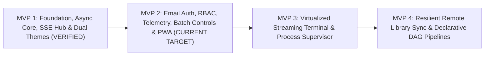

# Specification: Pareo V2 - Modernized Asynchronous Command & Orchestration Engine

**Document Version:** 2.2.0-MVP2-SPEC  
**Author:** Lead Systems Analyst & Agile Product Owner  
**Status:** Approved for Implementation (MVP 2 Target) — **Handoff to Coder to implement MVP 2.**  
**Target Architecture:** FastAPI Async Backend + SQLite WAL + Vanilla ES6+ SPA / PWA (SSE Streaming)  

---

## 1. Executive Summary & MVP 2 Mission

**Pareo** is an asynchronous, configuration-driven command orchestration and system execution engine engineered for Local Area Network (LAN) infrastructure, home servers, and distributed edge nodes. It bridges the gap between raw POSIX command-line interfaces and client-side web interactions by transforming resource-intensive terminal workloads—such as high-definition FFMPEG video transcoding, bidirectional remote filesystem synchronization, batch torrent downloads, and sibling application process supervision—into non-blocking, managed, recoverable, and observable background pipelines.

Following the successful verification and release of **MVP 1 (v2.0.0-mvp1)**—which established the non-blocking asynchronous subprocess core, SQLite WAL indexing, real-time Server-Sent Events (SSE) bus, and two bespoke signature themes (*Sony's Wipeout* and *Fallout Atompunk*) with 44/44 automated tests passing—**Pareo V2 enters MVP 2**.

### MVP 2 Primary Objectives:
1. **Identity & Security Layer:** Replace the temporary no-auth testing mode with production-grade email-based authentication (PBKDF2-HMAC-SHA256 with 100k iterations, 16-byte random salt), persistent SQLite session store, and Role-Based Access Control (`Admin`, `Operator`, `Viewer`).
2. **Host & Queue Telemetry Engine:** Deliver live host infrastructure telemetry (CPU load averages, RAM percentage, filesystem disk usage across allowed roots) and worker slot saturation metrics broadcast every 2 seconds over SSE.
3. **Interactive Batch Queue Controls:** Enable multi-select task operations with a persistent bottom action dock for batch Cancel, Retry, and Purge actions.
4. **Cross-Platform Progressive Web App (PWA):** Transform the frontend into an installable, mobile-optimized PWA for iOS and Android featuring `manifest.json`, `sw.js` app-shell caching, safe-area inset adaptation for notch/Dynamic Island devices, native-feeling bottom sheets, and haptic feedback.

---

## 2. Current Baseline: Pareo V2.0.0-MVP1 (Released & Verified)

### 2.1 Verified Production Baseline (Post-MVP 1)
The following capabilities were implemented and validated with 44/44 passing automated tests:
- **Port 9046 Default Binding:** Bound to `0.0.0.0:9046` across `run.py`, `run.sh`, and `pareo.service`, with dynamic override via the `PORT` environment variable.
- **Frictionless Local Execution Core:** Clean modular backend (`server.py`, `executor.py`, `database.py`, `broadcaster.py`, `task_runner.py`).
- **Async Non-Blocking Subprocess Core:** Subprocess operations execute via `run_async_subprocess()` / `asyncio.create_subprocess_exec` with explicit timeouts and process-group cleanup (`killpg`); zero single-thread event loop blocking during SSH or `ffprobe`.
- **Database Indexing & WAL PRAGMAs:** SQLite B-Tree indices (`idx_tasks_status`, `idx_tasks_queue_status`, `idx_tasks_start_time`) active alongside WAL mode, `synchronous=NORMAL`, `busy_timeout=5000`, and `wal_autocheckpoint=1000`.
- **Dynamic Path Portability & Input Bounds:** `BASE_DIR = Path(__file__).resolve().parent` eliminates hardcoded paths; `is_safe_path_string()` guards against newlines, control characters, and buffer overflows (preventing syscall crashes per lessons learned).
- **Real-Time SSE Bus (`GET /api/stream/events`):** Singleton `broadcaster.py` pushes `task_update`, `task_output`, and `task_counts` with drop-oldest queue overflow guards, completely retiring browser HTTP polling loops.
- **Bespoke Dual-Theme UI System:** Native CSS token implementation for "Sony's Wipeout" (`data-theme="wipeout"`) and "Fallout Atompunk" (`data-theme="fallout-pipboy"`), persistent in `localStorage`.
- **Responsive Ergonomics:** Mobile card conversion (`.task-card`), thumb-zone bottom navigation bar, >=44px touch targets, accessible non-blocking toasts (`showToast()`), and terminal auto-scroll lock.
- **Release Verification:** Released as `v2.0.0-mvp1` with all 44 automated regression tests passing.

---

## 3. Target Architecture: Pareo V2 (MVP 2 Scope)

```mermaid
flowchart TD
    subgraph Client ["Responsive PWA & Dual-Theme Client (SPA / PWA)"]
        PWA["PWA Engine: manifest.json & sw.js"]
        IOS["iOS Safe-Area & Gesture Bounds"]
        AND["Android Haptics & Install Banner"]
        THEMES["Theme Engine: Wipeout HUD / Fallout Pip-Boy"]
        AUTH_UI["Auth Modal & Role Badges"]
        BATCH_UI["Batch Multi-Select & Action Dock"]
        TELE_UI["Live Telemetry Gauges (CPU/RAM/Disk/Slots)"]
        SSE_SUB["Native EventSource Client: /api/stream/events"]
    end

    subgraph Server ["FastAPI Server (Pareo V2 Core)"]
        AUTH_DEP["RBAC Auth Middleware (Admin / Operator / Viewer)"]
        AUTH_API["Auth Endpoints (/api/auth/*)"]
        BATCH_API["Batch Queue Endpoints (/api/tasks/batch/*)"]
        TELE_API["Telemetry Engine (/api/telemetry)"]
        SSE_HUB["Async Event Broadcaster (SSE Hub)"]
        ASYNC_EXEC["Non-Blocking Subprocess Engine"]
    end

    subgraph Data ["Persistence & Cache"]
        USERS_DB[("SQLite: users table (PBKDF2-HMAC-SHA256)")]
        SESS_DB[("SQLite: sessions table (TTL Tokens)")]
        TASKS_DB[("SQLite: tasks & library_cache (WAL Mode)")]
        QUEUES["Async FIFO Queues (media, fs, network, default)"]
    end

    subgraph Host ["Host Infrastructure"]
        TELE_METRICS["System Telemetry (loadavg, meminfo, statvfs)"]
        WORKERS["POSIX Detached Process Runners (PGID setsid)"]
    end

    SSE_SUB <-->|SSE Stream & REST API| Server
    AUTH_API -->|Verify / Store| USERS_DB
    AUTH_API -->|Issue / Invalidate| SESS_DB
    AUTH_DEP -->|Validate Token| SESS_DB
    TELE_API -->|Sample Metrics| TELE_METRICS
    TELE_API -->|Push Every 2s| SSE_HUB
    BATCH_API -->|Batch Cancel/Retry/Purge| TASKS_DB
    BATCH_API -->|Signal Processes| WORKERS
```



---

## 4. Multi-MVP Phased Roadmap Context



- **MVP 1 (Released):** Foundation, non-blocking async execution, SQLite WAL indices, SSE stream bus, dual themes (*Sony's Wipeout* and *Fallout Atompunk*), responsive mobile navigation.
- **MVP 2 (Current Target):** Email-based authentication, user account management, persistent sessions, Role-Based Access Control (`Admin`, `Operator`, `Viewer`), host & queue telemetry engine, interactive batch queue controls, and cross-platform PWA for iOS & Android.
- **MVP 3 (Upcoming):** Virtualized 100k-line log terminal, regex in-terminal filtering, crash-restart process supervisor policies, and live process log streaming.
- **MVP 4 (Upcoming):** Async remote library diff scanner, visual sync diff matrix, and declarative DAG multi-stage workflow engine.

---

## 5. Detailed Specification: MVP 2 (Current Implementation Target)

### 5.1 Email-Based Authentication & User Accounts

#### 5.1.1 Database Schema Additions (`database.py`)
```sql
CREATE TABLE IF NOT EXISTS users (
    user_id TEXT PRIMARY KEY,
    email TEXT UNIQUE NOT NULL,
    password_hash TEXT NOT NULL,
    salt TEXT NOT NULL,
    role TEXT NOT NULL DEFAULT 'Viewer',
    created_at TEXT NOT NULL,
    last_login TEXT,
    is_active INTEGER NOT NULL DEFAULT 1
);

CREATE INDEX IF NOT EXISTS idx_users_email ON users(email);

CREATE TABLE IF NOT EXISTS sessions (
    session_token TEXT PRIMARY KEY,
    user_id TEXT NOT NULL,
    created_at TEXT NOT NULL,
    expires_at TEXT NOT NULL,
    last_active TEXT NOT NULL,
    FOREIGN KEY(user_id) REFERENCES users(user_id) ON DELETE CASCADE
);

CREATE INDEX IF NOT EXISTS idx_sessions_user_id ON sessions(user_id);
CREATE INDEX IF NOT EXISTS idx_sessions_expires_at ON sessions(expires_at);
```

#### 5.1.2 Cryptographic Security Requirements
- **Algorithm:** PBKDF2-HMAC-SHA256.
- **Iterations:** 100,000 iterations minimum.
- **Salt:** 16 bytes of cryptographically secure random bytes generated via `secrets.token_bytes(16)`.
- **Storage Format:** Salt and hash stored as lowercase hex strings.
- **Verification:** Verification strictly performed using `hmac.compare_digest` to prevent timing side-channel attacks.
- **Session Tokens:** Generated via `secrets.token_urlsafe(32)`. Persisted in SQLite with a default TTL of 2 days (48 hours), refreshed upon active requests.

#### 5.1.3 Endpoints Specification (`server.py`)
1. `GET /api/auth/status`:
   - Returns `{ "initialized": true/false, "user_count": N }`.
   - If `initialized == false` (no users exist), frontend immediately displays the **Initial Admin Setup** wizard.
2. `POST /api/auth/setup-admin`:
   - Payload: `{"email": "admin@example.com", "password": "...", "confirm_password": "..."}`.
   - Allowed **only** when `user_count == 0`.
   - Creates the root administrative user with `role = "Admin"`, creates a session, and returns `{ "token": "...", "user": { ... } }`.
3. `POST /api/auth/register`:
   - Payload: `{"email": "user@example.com", "password": "..."}`.
   - If user already exists: returns HTTP 400 `Email already registered`.
   - If this is the first user registered, assign `role = "Admin"`. Otherwise assign `role = "Viewer"` (or `role = "Operator"` if configured).
   - Returns `{ "token": "...", "user": { ... } }`.
4. `POST /api/auth/login`:
   - Payload: `{"email": "user@example.com", "password": "..."}`.
   - Validates user exists and `is_active == 1`.
   - Hashes supplied password against stored salt and compares via `hmac.compare_digest`.
   - On match, generates a new session token, updates `last_login`, and returns `{ "token": "...", "user": { "user_id": "...", "email": "...", "role": "..." } }`.
   - On mismatch, returns HTTP 401 `Invalid email or password`.
5. `POST /api/auth/logout`:
   - Requires authenticated session token.
   - Deletes session token from `sessions` table. Returns `{ "status": "logged_out" }`.
6. `GET /api/auth/me`:
   - Requires authenticated session token.
   - Returns current user record: `{ "user_id": "...", "email": "...", "role": "...", "created_at": "..." }`.

#### 5.1.4 Token Authentication Dependency & Route Protection
- Fast dependency function: `async def get_current_user(request: Request) -> dict`.
- Token extraction precedence:
  1. `Authorization: Bearer <token>`
  2. `X-Pareo-Auth: <token>`
  3. `?token=<token>` (for SSE `EventSource` connections and Service Worker downloads).
- If system is uninitialized (`user_count == 0`), access to `/api/auth/setup-admin` and `/api/auth/status` is open, while other endpoints require admin setup.
- If initialized, invalid or missing token raises HTTP 401.

---

### 5.2 Role-Based Access Control (RBAC)

#### 5.2.1 Role Definitions
| Role | Description | Allowed Actions | Restricted Actions |
| :--- | :--- | :--- | :--- |
| **Admin** | Superuser / System Owner | All actions: User management, task creation/cancellation/retry/purge, file operations, switchboard execution, process supervision start/stop/kill. | None |
| **Operator** | Infrastructure Operator | Task creation, retry, cancellation, batch queue management, library synchronization, file explorer operations. | System process supervision kill/stop, user management, configuration editing. |
| **Viewer** | Read-Only Monitor | View dashboard, inspect tasks, stream logs via SSE, view telemetry gauges, inspect process status, view libraries. | Cannot submit, cancel, retry, or purge tasks; cannot execute shell commands; cannot modify files. |

#### 5.2.2 Enforcement Mechanism
- Dependency helper: `def require_role(allowed_roles: List[str])`:
  - Validates `current_user["role"] in allowed_roles`.
  - If unauthorized, raises HTTP 403 `Forbidden: Insufficient privileges for this operation`.
- Route assignment:
  - `POST /api/execute/*` -> `require_role(["Admin", "Operator"])`
  - `POST /api/tasks/{task_id}/cancel` -> `require_role(["Admin", "Operator"])`
  - `POST /api/tasks/{task_id}/retry` -> `require_role(["Admin", "Operator"])`
  - `POST /api/tasks/batch/*` -> `require_role(["Admin", "Operator"])`
  - `POST /api/processes/start`, `/api/processes/stop` -> `require_role(["Admin"])`
  - `GET /api/tasks`, `GET /api/stream/events`, `GET /api/telemetry` -> `require_role(["Admin", "Operator", "Viewer"])`

---

### 5.3 Host & Queue Telemetry Engine

#### 5.3.1 Telemetry Metrics Specification
The telemetry collector gathers host hardware state without external heavyweight agents:
1. **CPU Metrics:**
   - Load averages: 1-minute, 5-minute, and 15-minute load averages via `os.getloadavg()`.
   - CPU count: `os.cpu_count()`.
   - Per-core CPU utilization percentage calculated from `/proc/stat` delta sampling.
2. **RAM Metrics:**
   - Extracted from `/proc/meminfo`:
     - Total RAM (MB), Free RAM (MB), Available RAM (MB), Cached RAM (MB).
     - RAM Utilization percentage: `((MemTotal - MemAvailable) / MemTotal) * 100`.
3. **Filesystem Storage Metrics:**
   - Evaluated using `os.statvfs` across all configured `allowed_roots`:
     - Mount path, Total GB, Used GB, Free GB, and Used percentage.
4. **Queue Worker Saturation Metrics:**
   - Retrieved directly from `executor.py`:
     - Per queue (`media`, `fs`, `network`, `default`):
       - `concurrency_limit`: Max parallel workers configured.
       - `active_workers`: Current running tasks in slot.
       - `pending_tasks`: Current depth of `asyncio.Queue`.
       - `saturation_pct`: `(active_workers / concurrency_limit) * 100`.

#### 5.3.2 Endpoints & SSE Streaming
1. `GET /api/telemetry`:
   - Returns the immediate telemetry snapshot as JSON.
2. **SSE Telemetry Event (`telemetry`):**
   - Background async worker in `broadcaster.py` / `executor.py` broadcasts a `telemetry` event every 2.0 seconds over `GET /api/stream/events`:
     ```json
     {
       "timestamp": "2026-10-11T07:35:00Z",
       "cpu": {
         "load_1m": 0.45,
         "load_5m": 0.52,
         "load_15m": 0.48,
         "cores": 4,
         "utilization_pct": 18.2
       },
       "memory": {
         "total_mb": 16384,
         "used_mb": 4210,
         "available_mb": 12174,
         "utilization_pct": 25.7
       },
       "disk": [
         {
           "path": "/home/sayang",
           "total_gb": 465.8,
           "used_gb": 124.3,
           "free_gb": 341.5,
           "utilization_pct": 26.7
         }
       ],
       "queues": {
         "media": { "active": 1, "pending": 0, "limit": 1, "saturation_pct": 100.0 },
         "fs": { "active": 0, "pending": 1, "limit": 2, "saturation_pct": 0.0 },
         "network": { "active": 0, "pending": 0, "limit": 2, "saturation_pct": 0.0 },
         "default": { "active": 0, "pending": 0, "limit": 1, "saturation_pct": 0.0 }
       }
     }
     ```

#### 5.3.3 UI Telemetry Components
- **Telemetry Bar / Modal:** Rendered in navigation header and mobile bottom sheet.
- **Theme Specific Visualizations:**
  - **"Sony's Wipeout":** High-velocity segmented horizontal HUD tachometer bars in electric cyan (`#00f0ff`), neon orange (`#ff5500`), and acid yellow (`#eaff00`).
  - **"Fallout Pip-Boy":** Glowing phosphor green analog needle meter graphics and retro ASCII dials (`[||||||......] 48%`) with vacuum tube glow.

---

### 5.4 Interactive Batch Queue Controls

#### 5.4.1 Batch Operations Endpoints (`server.py`)
1. `POST /api/tasks/batch/cancel`:
   - Payload: `{"task_ids": ["task-1", "task-2", ...]}`.
   - Requires `Admin` or `Operator` role.
   - Cancels running jobs (`os.killpg`) and marks pending jobs as `Cancelled`.
   - Returns `{ "cancelled_count": N, "task_ids": [...] }`.
2. `POST /api/tasks/batch/retry`:
   - Payload: `{"task_ids": ["task-1", "task-2", ...]}`.
   - Requires `Admin` or `Operator` role.
   - Clears task outputs and re-queues them into their designated queues.
   - Returns `{ "retried_count": N, "task_ids": [...] }`.
3. `POST /api/tasks/batch/purge`:
   - Payload: `{"task_ids": ["task-1", "task-2", ...]}`.
   - Requires `Admin` or `Operator` role.
   - Removes completed, failed, or cancelled tasks from SQLite.
   - Returns `{ "purged_count": N, "task_ids": [...] }`.

#### 5.4.2 Frontend Multi-Select & Action Dock (`static/`)
- **Multi-Select Checkboxes:**
  - Added to `.task-card` (mobile) and `#tasks-table tbody tr` (desktop).
  - "Select All" toggle in table header and card view toolbar.
  - Selecting >= 1 task elevates the **Floating Bottom Action Dock** (`.batch-action-dock`).
- **Action Dock Capabilities:**
  - Counter badge: `"3 Tasks Selected"`.
  - Action buttons with 44px+ touch targets:
    - 🛑 **Cancel All Selected** (themed confirm sheet).
    - 🔁 **Retry All Selected**.
    - 🗑️ **Purge All Selected**.
    - ✕ **Deselect All**.
  - Respects RBAC: Buttons disabled or hidden if current user has `Viewer` role.

---

### 5.5 Truly Responsive Cross-Platform PWA (iOS & Android)

#### 5.5.1 Web App Manifest (`static/manifest.json`)
```json
{
  "name": "Pareo V2 Orchestration Engine",
  "short_name": "Pareo",
  "start_url": "/",
  "display": "standalone",
  "background_color": "#07090e",
  "theme_color": "#07090e",
  "orientation": "any",
  "icons": [
    {
      "src": "/static/icons/icon-192.png",
      "sizes": "192x192",
      "type": "image/png",
      "purpose": "any maskable"
    },
    {
      "src": "/static/icons/icon-512.png",
      "sizes": "512x512",
      "type": "image/png",
      "purpose": "any maskable"
    }
  ]
}
```

#### 5.5.2 Service Worker (`static/sw.js`)
- **Cache-First App Shell:** Caches core static assets (`/`, `/static/index.html`, `/static/style.css`, `/static/app.js`, `/static/manifest.json`, icons).
- **Network-First for Dynamic Endpoints:** Direct network pass-through for `/api/*` and persistent SSE streams (`/api/stream/events`), ensuring fresh real-time data.
- **Offline Resilience:** Dispatches in-app banner/toast when connectivity drops (`navigator.onLine == false`) and re-synchronizes queues on reconnect.

#### 5.5.3 iOS Specific PWA Ergonomics
- **Safe-Area Insets:**
  - Meta tag: `<meta name="viewport" content="width=device-width, initial-scale=1.0, viewport-fit=cover">`.
  - CSS adaptation:
    ```css
    header {
        padding-top: calc(var(--space-2) + env(safe-area-inset-top));
    }
    .bottom-nav, .batch-action-dock {
        padding-bottom: calc(var(--space-2) + env(safe-area-inset-bottom));
    }
    ```
- **Apple Meta Tags:**
  - `<meta name="apple-mobile-web-app-capable" content="yes">`
  - `<meta name="apple-mobile-web-app-status-bar-style" content="black-translucent">`
  - `<link rel="apple-touch-icon" href="/static/icons/apple-touch-icon.png">`
- **Native-Feeling Bottom Sheets:** Modals on mobile (<640px) transform into bottom sheets with grabber handles, touch drag-down to dismiss, and `overscroll-behavior-y: contain`.

#### 5.5.4 Android Specific PWA Ergonomics
- **In-App Install Banner:** Captures `beforeinstallprompt` event and reveals an "Install App" button in the header.
- **Haptic Feedback:** Native vibration feedback via `navigator.vibrate([15])` upon batch actions, task triggers, or error notifications on supported hardware.

---

## 6. UI/UX Design System Extensions for MVP 2

### 6.1 Authentication Modal
- Modal dialog with email/password input fields styled natively in both themes:
  - *Wipeout:* Cockpit carbon inputs, electric cyan hairline borders, angled buttons.
  - *Fallout Pip-Boy:* Sunken CRT terminal inputs, phosphor green beam glow, retro mono typography.
- Initial Admin Setup indicator if server reports `initialized: false`.
- User profile badge in top navigation displaying active email and role tag (`ADMIN`, `OPERATOR`, `VIEWER`).

### 6.2 Telemetry Dashboard Components
- **Top Bar Micro-Gauges:**
  - CPU percentage meter.
  - RAM usage badge.
  - Worker slots active count (`Media: 1/1 | FS: 0/2 | Net: 0/2`).
- **Telemetry Expandable Panel:**
  - Detailed storage breakdown by root.
  - Load average sparkline / bar indicators.
  - Queue depth saturation meters.

### 6.3 Batch Action Dock
- Fixed bottom dock elevated at `z-index: 100`, positioned above the mobile bottom navigation bar.
- Animated slide-in from bottom when `selectedTasks.size > 0`.
- Includes clear tap targets >= 44px x 44px with keyboard navigation support.

---

## 7. Regression Prevention & Lessons Learned Integration

Per `/global_knowledge/lessons_learned.md`:
1. **Preserve Documented APIs & Extension Points:** All existing endpoints from MVP 1 (`/api/tasks`, `/api/execute/*`, `/api/stream/events`) and configuration structures must remain fully operational.
2. **Preserve Living Documentation:** Ensure `README.md`, `FAQ.md`, and `STYLEGUIDE.md` are continuously updated alongside code changes.
3. **Guard Polymorphic Inputs:** Path parameters and email inputs must be sanitized against newlines, control characters, and buffer overflows (`len > 1024`).
4. **Disambiguate Regex Transformations:** No sequential overlapping regex replacements in converters.
5. **Continuous Full Regression Testing:** All 44 tests from MVP 1 must continue to pass 100% alongside new MVP 2 tests.

---

## 8. Acceptance Criteria & Verification Matrix for MVP 2

### 8.1 Email Authentication & User Management
- [ ] Database contains `users` and `sessions` tables with proper B-Tree indices (`idx_users_email`, `idx_sessions_expires_at`).
- [ ] Passwords stored using PBKDF2-HMAC-SHA256 with >= 100,000 iterations and 16-byte random salt.
- [ ] Constant-time verification implemented using `hmac.compare_digest`.
- [ ] `GET /api/auth/status` detects first-run state (`initialized: false` when 0 users exist).
- [ ] `POST /api/auth/setup-admin` securely provisions the initial Admin user.
- [ ] `POST /api/auth/register` creates user accounts with default role assignment.
- [ ] `POST /api/auth/login` verifies credentials, creates active session, and returns bearer token.
- [ ] `POST /api/auth/logout` invalidates active session.
- [ ] `GET /api/auth/me` returns current user profile and role.
- [ ] Expired or invalid session tokens return HTTP 401.

### 8.2 Role-Based Access Control (RBAC)
- [ ] Route handlers enforce role requirements:
  - `Admin`: Full access to execution, processes, configuration, and batch actions.
  - `Operator`: Full access to task execution and batch actions; restricted from process supervision termination.
  - `Viewer`: Read-only access to dashboard, tasks, logs, telemetry; blocked from submitting, retrying, cancelling, or purging tasks (HTTP 403).
- [ ] UI dynamically hides or disables restricted actions based on `current_user.role`.

### 8.3 Host & Queue Telemetry Engine
- [ ] `GET /api/telemetry` returns CPU load averages, per-core CPU %, RAM %, storage per root, and queue slot saturation.
- [ ] SSE stream (`/api/stream/events`) broadcasts `telemetry` event every 2.0 seconds.
- [ ] Frontend displays live telemetry gauges in both "Sony's Wipeout" and "Fallout Pip-Boy" themes.
- [ ] Host resource inspection handles missing `/proc` entries gracefully without crashing on non-Linux OS.

### 8.4 Interactive Batch Queue Controls
- [ ] Task cards (mobile) and rows (desktop) feature accessible multi-select checkboxes.
- [ ] Floating/sticky bottom action dock displays selected count and action buttons.
- [ ] `POST /api/tasks/batch/cancel` cancels all selected tasks in a single request.
- [ ] `POST /api/tasks/batch/retry` retries all selected failed/cancelled tasks.
- [ ] `POST /api/tasks/batch/purge` purges all selected finished tasks.
- [ ] Batch actions trigger clear feedback toasts and update UI immediately without full page reloads.

### 8.5 Cross-Platform PWA for iOS & Android
- [ ] Valid `manifest.json` served at `/static/manifest.json` with standalone mode, dynamic theme color, and icons.
- [ ] Service worker `sw.js` registered and active, caching static app shell assets.
- [ ] Dynamic API and SSE streams bypass cache for live real-time updates.
- [ ] iOS viewports support `viewport-fit=cover` and notch/Dynamic Island safe-area insets (`env(safe-area-inset-top)`, `env(safe-area-inset-bottom)`).
- [ ] Mobile modals render as touch-draggable bottom sheets with `overscroll-behavior-y: contain`.
- [ ] Android install prompt event (`beforeinstallprompt`) captured with header install banner.
- [ ] Haptic feedback (`navigator.vibrate`) triggers on key user actions on supported mobile devices.

### 8.6 Regression Test Verification
- [ ] All 44 automated tests from MVP 1 pass with zero regressions.
- [ ] New automated unit and integration tests added in `tests/test_auth.py`, `tests/test_telemetry.py`, `tests/test_batch_queue.py`, and `tests/test_pwa.py`.
- [ ] Total test suite passes cleanly with `pytest -v`.

---

## 9. Formal Handoff Declaration

**Handoff to Coder to implement MVP 2.**

The Lead Systems Analyst & Agile Product Owner has completed the system analysis, finalized the comprehensive MVP 2 specification, updated living project documentation, and established the acceptance criteria matrix. The Coder agent is authorized to begin implementation of MVP 2.
